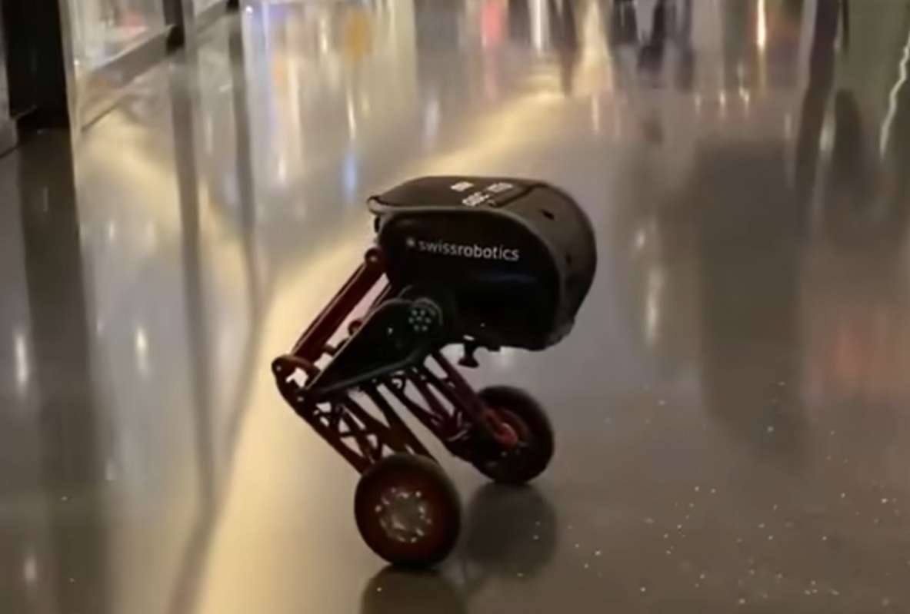

# 大概思路？

## 作品原型（或企业选题机械）

### 内容简介（限400字以内）

制作一个六轴双轮足机器人，实现ubw跟随、轮式高效巡航、足式跨障的功能。同时要实现整机重量≤6kg，机高≤500mm，能上200mm台阶和跨越200mm的沟渠，以及两小时的续航，消费级全塑低成本六项功能。

## 作品原型（或企业选题机械）照片，现有数字孪生技术基础（限300字以内）

## 作品原型获奖证书照片（或企业选题机械研究思路，限300字）

首先分析开链四连杆，并联腿，偏置并联腿和串联腿的机械结构优劣，选出基础腿部结构方案后，使用matlab进行连杆数据计算，得出当前参数下能满足的跨越地形能力。接着在sw完成简易建模，打印零件进行基础测试。接着进一步制作镂空，材料优化来实现轻量化等功能。
