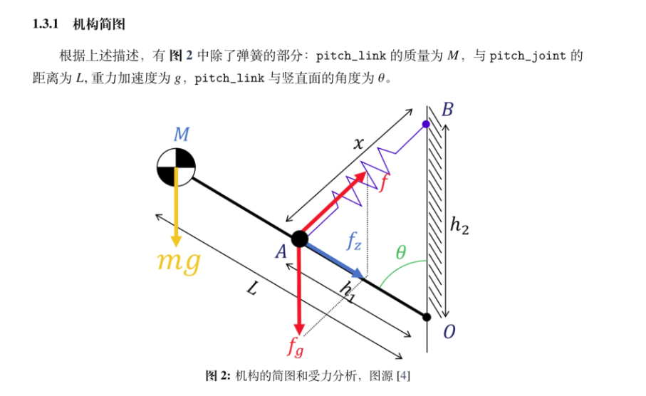
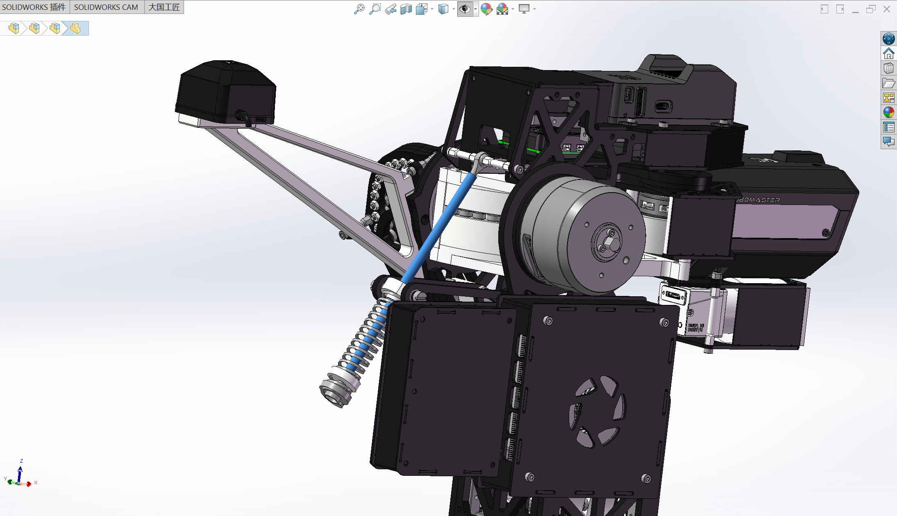
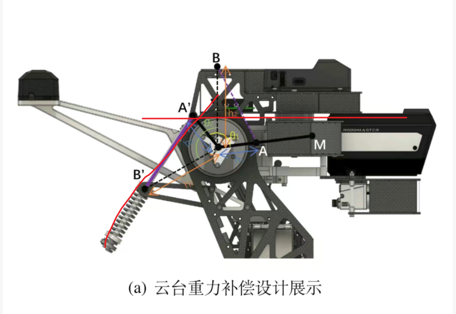

# 重补弹簧的参数选择思路

首先明确核心公式是

k=

即计算出k值去挑选弹簧的款式

但是我们会发现一个问题，h1和h2该如何确定？以及拉伸的轴要设计多长？

就是蓝色选择的这一根

我觉得可以先自行大致设定h1和h2的参数（比如参考各家开源之类的），然后计算出k值，然后在网上寻找压簧的款式，去看看整体k值的分布情况，再进一步优化h1和h2的参数，等明确完使用的弹簧后，再去固定h1和h2的参数

接着自行根据设计，确定摆放位置

比如广工的这个，把整个机构旋转θ角后，将A’B’与自行设置的水平线相交，相交点就是放置鱼眼轴承的地方。然后把A’B’延长，即增加压簧零原长的长度，就是整个轴的长度了。

这样整个弹簧补偿的结构参数就基本完成了。
