# 弹簧重补 技术报告

本文用于云台弹簧重力补偿学习

讲解结构原理与设计、选型思路

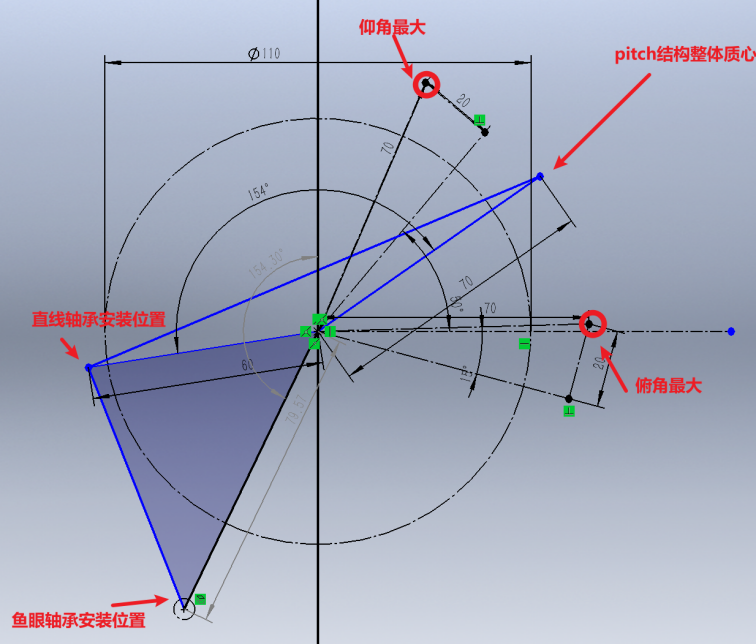

（此处所用图为华南虎25英雄开源）

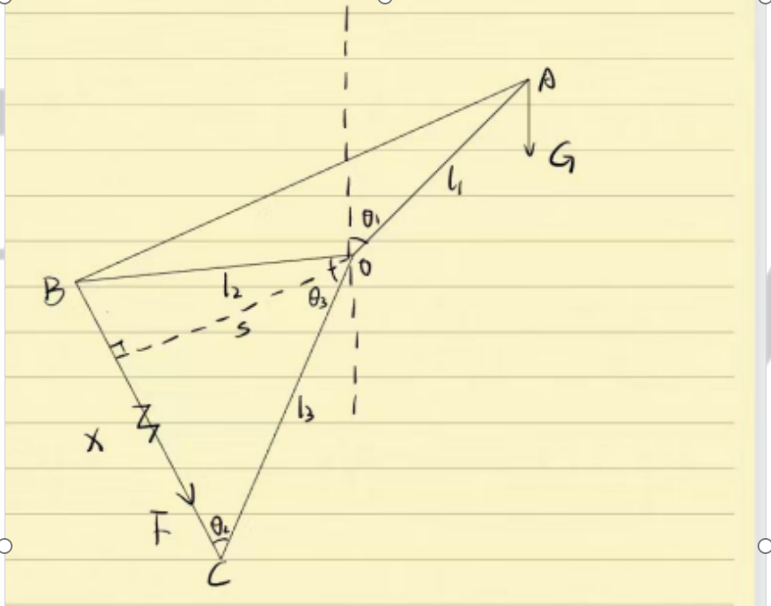

公式推导：

受力分析：

云台pitch所受到的重力矩为：

G*sin（θ1）

弹簧所施加于pitch轴的弹力矩为：

F*s=k*Δx*s

要使pitch保持平衡，则有：

G*sin（θ1）=  F*s=k*Δx*s

化简后有：

K = $\frac{G\cdot \sin (\theta 1)}{\Delta x\cdot s}$

由于

s=l3*sin（θ2）

回代得：

K = $\frac{G\cdot \sin (\theta 1)}{\Delta x\cdot l3\cdot \sin (\theta 2)}$

又因为

$\frac{x}{\sin (\theta 3)}$= $\frac{l2}{\sin (\theta 2)}$

sin(θ2)= $\frac{l2\cdot \sin (\theta 3)}{x0+\Delta x}$

回代得：

K= $\frac{G\cdot l1}{l2\cdot l3}\cdot \frac{\sin (\theta 1)}{\sin (\theta 3)}\cdot \frac{x}{\Delta x}$

若要使k为恒定值即弹簧选型不变

则要:

$\frac{\sin (\theta 1)}{\sin (\theta 3)}$=1  、 $\frac{x}{\Delta x}$=1

即θ1=θ3、x=Δx

最后化简得

K= $\frac{G\cdot l1}{l2\cdot l3}$

由公式可得，只要弹簧选型满足k值，则在任意角度下，pitch均能保持平衡

## 具体设计过程

在正常来讲，x（弹簧长度）=x0（弹簧初始长度）+Δx

则此时要求x0=0

因此我们引出广工开发出来的零原长弹簧

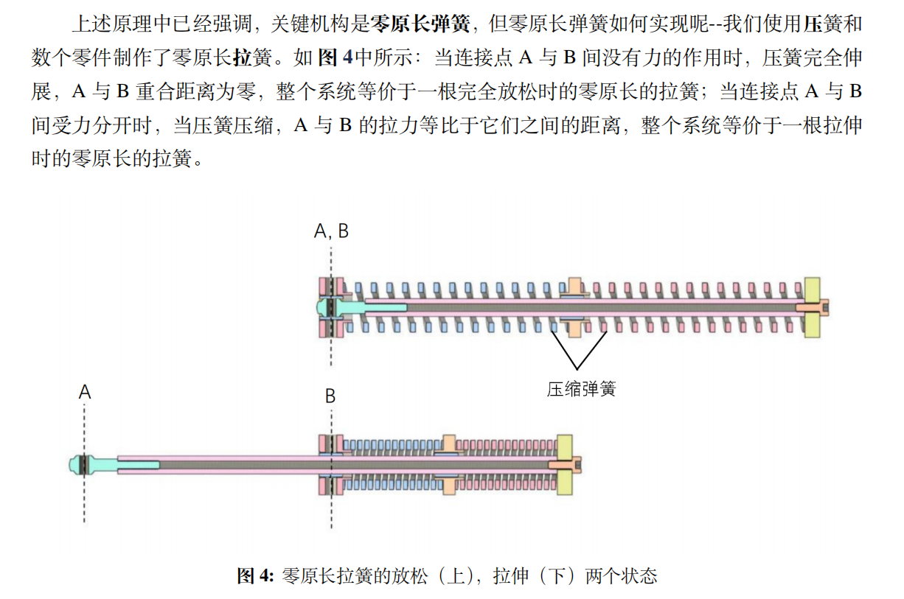

（此为广工图）

若是再简单点来讲就是如下图所示

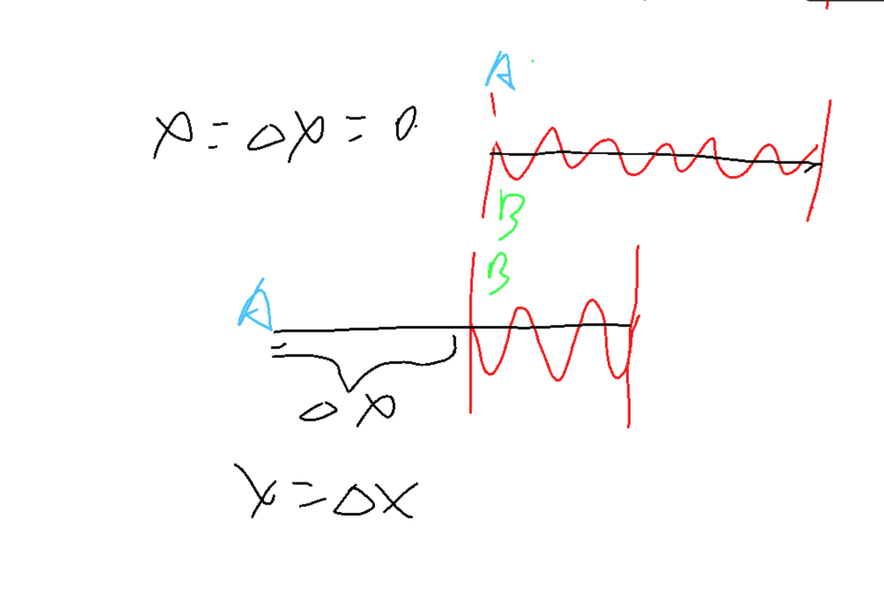

我们将弹簧原长状态下放置在两个限位块中

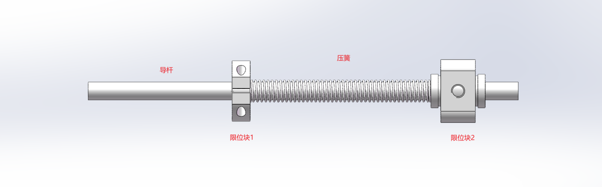

当限位块1于限位块2发生相对运动的时候

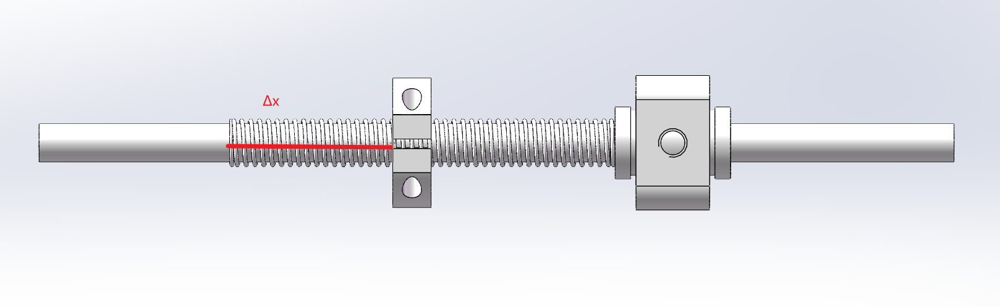

在建模中超过限位块的部分，即为此时弹簧的压缩量

接下来我们具体讲一下整个重补系统补偿的草图绘制

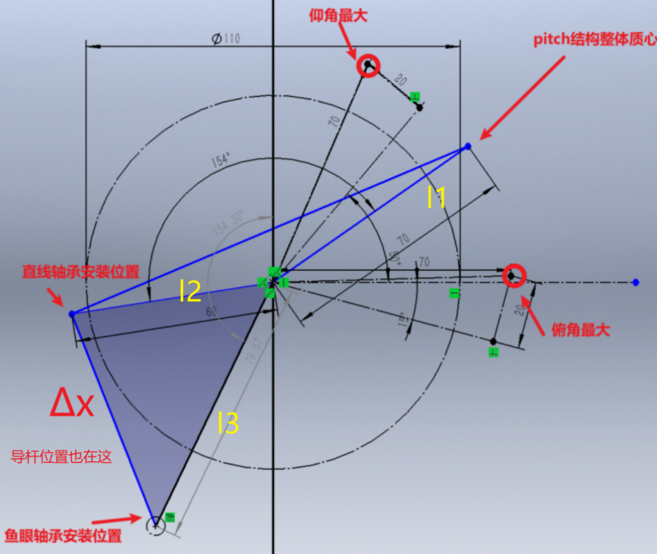

还是这张图

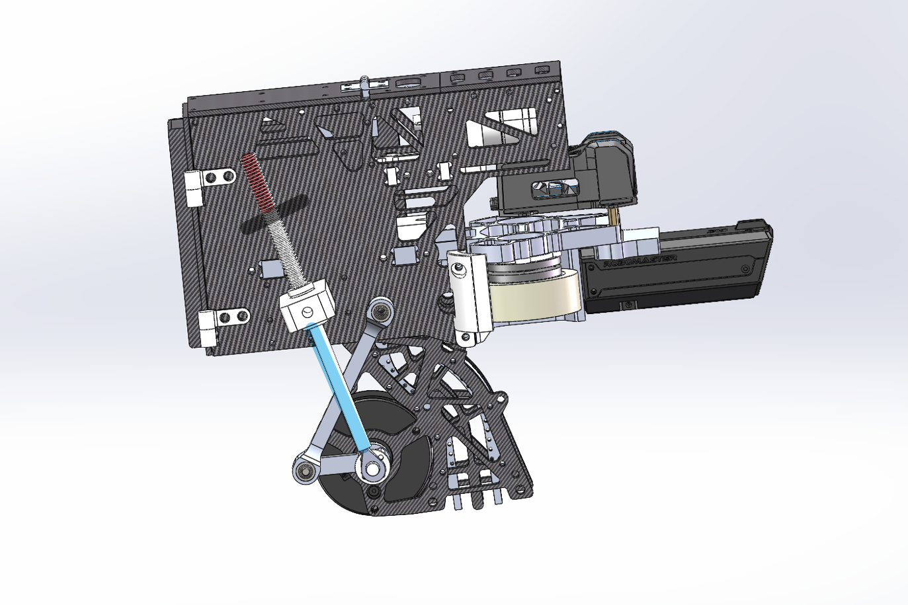

以这张图为例子

蓝色为Δx，黑色为抱紧联轴器，即限位块1

当pitch为该状态的时候，上方压簧的压缩量（即红色部分）要等于蓝色的部分

Ps：压簧一定要时刻保持压缩，在个别情况下只有在仰角最高处可以让Δx为0，否则整个重补系统会失效

讲完了草图绘制，现在来讲一下弹簧如何选型

首先是k的计算公式

K= $\frac{G\cdot d^{4}}{8\cdot D^{3}\cdot n}$

可以看到整个式子是比较复杂的，并且计算量庞大，手算来解决是效率较低的，因此我们在这里引入了matlab来帮助我们计算出数据。

我们先明确各个参数所代表的含义

G：弹簧所用材料的剪切模量，比如弹簧钢就是79000MPa

d：线径（mm）

D：中径（mm）、外径为D+d，内径为D-d

n：有效圈数（直接关系到弹簧原长）

我们通过matlab计算后会生成一个表格，内涵200组数据，我先讲解一下如何去使用这个表格选型

因为在市面上的压簧能购买到的参数是这样的：线径从0.2开始，每次增加0.1，外径按照每5mm去递增，弹簧长度从5mm开始，每5mm递增到50mm，后面按照10mm递增到100mm

因此，表格里生成的绝大部分数据，是用不了的，因为他所对应的线径和外径在标准件里并不存在，而单独定制的话一根就要将近一百块，十分不划算。

因此我们在使用表格的时候优先对线径和外径进行筛选，先选择出来能够买到的参数，再去进行权衡比较

筛选功能：随便点一行表头，右键，有筛选，然后就会在下方出现一根小箭头，后面的操作不再赘述

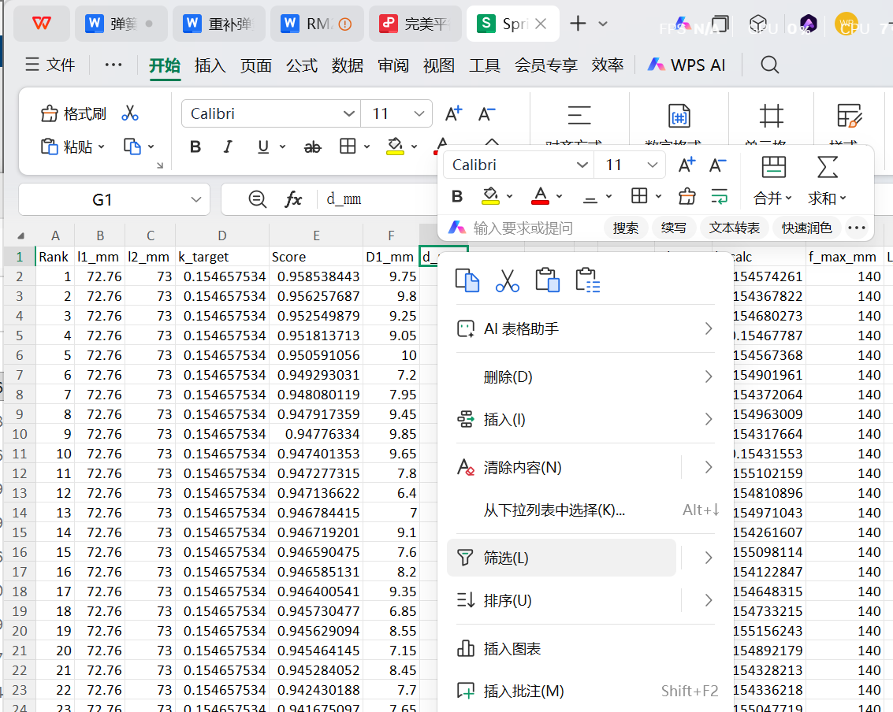

而我在代码中设置了额外的两个参数，一个是得分：长度优先，以及线径在一个值内优先，这样可以让我们选型的时候确保有充足的压缩量，但整体分数score的作用不大。而最后一行Deviation_percent表达的是于我们目标k值之间的误差，整体偏差都很小，但还是可以作为一个选型时候的倾向参考。

在实车的时候，我们会遇到各种因素的影响。比如说线材的重力，pitch的摩擦等等因素，因此我们计算出来的k值必然是不准确的，这个时候我们就需要根据实际情况去适量有一个偏差的倾向了。所以买的时候可以多买几根试试。

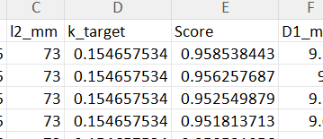

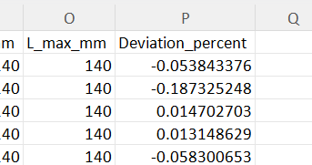

接下来我贴出来代码，并且在里面穿插当你想要改变一些值的时候要如何去修改代码来满足你的要求。

PS：每一次计算之后的参数都会更新在同一个文件中，所以每次要重新计算之前，记得要关掉你的表格！！！

function spring_design_ID_5_to_10()

% =========================================================

% 内径限制在 5mm ~ 10mm 之间，形变量要求 >= 100mm

% 需求变更：弹簧长点没关系，强调必须时刻保持有压缩量（留足余量）

% =========================================================

clc; clear; close all;

%% 1. 用户输入区 (每次修改这里重新运行)

% =========================================================

l1和l2的参数就在这里修改l1和l2的参数就在这里修改    l1 = 72.76;    % 力臂1 (mm)

l2 = 73;       % 力臂2 (mm)

% =========================================================

当你的质量和质心坐标改变时修改这里当你的质量和质心坐标改变时修改这里

% 计算目标刚度 k

k_target = (11.29 * 72.76) / (l1 * l2);

fprintf('【用户指定参数】l1 = %.2f mm, l2 = %.2f mm\n', l1, l2);

fprintf('【理论目标刚度】k_target = %.5f N/mm\n', k_target);

当你对材料和线径内径等等有其他要求的时候可以改这里。这里形变量需求也是在这里改，也就是最大压缩量为多少当你对材料和线径内径等等有其他要求的时候可以改这里。这里形变量需求也是在这里改，也就是最大压缩量为多少

%% 2. 参数搜索与筛选

G = 79000;          % 弹簧钢剪切模量 (MPa)

min_ID = 5;         % 最小内径约束 (mm)

max_ID = 10;        % 最大内径约束 (mm)

min_travel = 100;   % 最小形变量约束 (mm)

% 搜索范围设定

这边同理，起始值：每次改变值：结束值这边同理，起始值：每次改变值：结束值    d_list = 0.4:0.05:2.0;      % 线径范围 (mm)

D_list = 5:0.2:15;          % 中径范围 (mm)

% 初始化数据矩阵

valid_springs = [];

fprintf('正在搜索内径 5~10mm、形变 >= 100mm 的弹簧组合...\n');

for d = d_list

for D = D_list

D1 = D - d;

D2 = D + d;

if D1 < min_ID || D1 > max_ID

continue;

end

% 反推所需有效圈数 n

n_float = (G * d^4) / (8 * D^3 * k_target);

n = round(n_float);

% 放宽圈数上限（因为行程要求100mm，需要更多圈数来保证不压死）

这个地方修改起来比较复杂，不过一般对整体结果影响不大，所以不管他，不放心就给ai吧这个地方修改起来比较复杂，不过一般对整体结果影响不大，所以不管他，不放心就给ai吧            if n < 5 || n > 75

continue;

end

% 计算实际刚度 k_calc

k_calc = (G * d^4) / (8 * D^3 * n);

err = abs(k_calc - k_target) / k_target;

if err > 0.10

continue;

end

% 计算压并高度 Hb

Hb = (n + 2) * d;

这个地方在前面就修改了这个地方在前面就修改了

% 约束：最大压缩量 >= 100mm

H0_min = Hb + min_travel;

即表示弹簧最长为300mm即表示弹簧最长为300mm            % 放宽自由长度上限，因为“弹簧长点也没关系”，但受限于导杆稳定性，最高限制在 300mm

if H0_min > 300

continue;

end

% 【核心变更】自由长度搜索范围：从 H0_min 开始，向上延伸 0~40mm 的余量

当你弹簧最长的300修改后，你这个地方对应的300也要修改，这里的+40是给的弹簧初始预压余量，可以不必理会当你弹簧最长的300修改后，你这个地方对应的300也要修改，这里的+40是给的弹簧初始预压余量，可以不必理会            % 这样能筛选出不仅满足 100mm 行程，还留有额外压缩余量的长弹簧

H0_max = min(300, H0_min + 40);

H0_list = H0_min : 2 : H0_max;

for H0 = H0_list

f_max = H0 - Hb;      % 最大压缩量

L_max = f_max;        % 最大伸长量

if f_max < min_travel

continue;

end

% ---------- 评分机制（反转：奖励长弹簧/大余量） ----------

% 1. 线径评分 (0.8~1.5mm 易采购且稳定)

后面这个评分机制我也不会，ai写的，你要是有其他倾向交给ai修改就行了后面这个评分机制我也不会，ai写的，你要是有其他倾向交给ai修改就行了                if d >= 0.8 && d <= 1.5

score_d = 1.0;

elseif d < 0.8

score_d = d / 0.8;

else

score_d = 1.0 - (d - 1.5) / 1.0;

if score_d < 0, score_d = 0; end

end

% 2. 刚度匹配评分

score_k = 1.0 - err / 0.10;

% 3. 【新】压缩余量评分（核心逻辑：越长越好，保留更多预压缩量）

% 余量 = 实际自由长度 - 刚好满足100mm行程的长度

% 余量达到 40mm 时得满分 1.0

score_margin = (H0 - H0_min) / 40;

if score_margin > 1.0, score_margin = 1.0; end

% 4. 行程效率评分（自由长度中真正用于工作的比例）

score_travel = min_travel / H0;

% 综合评分：提高余量评分的权重，降低其他评分权重

total_score = 0.15*score_d + 0.35*score_k + 0.4*score_margin + 0.1*score_travel;

dev_percent = (k_calc - k_target) / k_target * 100;

valid_springs = [valid_springs; total_score, d, D2, D, n, H0, Hb, k_calc, f_max, dev_percent];

end

end

end

%% 3. 结果排序与提取

if isempty(valid_springs)

fprintf('⚠️ 未能找到满足条件的弹簧组合。\n');

return;

end

[~, idx] = sort(valid_springs(:, 1), 'descend');

valid_springs_sorted = valid_springs(idx, :);

max_all = min(200, size(valid_springs_sorted, 1));

All_Data_Final = valid_springs_sorted(1:max_all, :);

top_n = min(20, size(valid_springs_sorted, 1));

Top_20 = valid_springs_sorted(1:top_n, :);

fprintf('✅ 搜索完成！共筛选出 %d 组符合要求的弹簧。\n', size(valid_springs, 1));

%% 4. 导出到 Excel

output_filename = 'Springs_Long_With_Margin.xlsx';

if exist(output_filename, 'file')

delete(output_filename);

end

VarNames = {'Rank', 'l1_mm', 'l2_mm', 'k_target', 'Score', 'D1_mm', 'd_mm', 'D2_mm', 'D_mm', ...

'n', 'H0_mm', 'Hb_mm', 'k_calc', 'f_max_mm', 'L_max_mm', 'Deviation_percent'};

% 生成表格的循环逻辑（与之前一致，省略重复代码）

T_all = array2table(zeros(max_all, 16), 'VariableNames', VarNames);

for i = 1:max_all

r = All_Data_Final(i, :);

T_all.Rank(i) = i; T_all.l1_mm(i) = l1; T_all.l2_mm(i) = l2; T_all.k_target(i) = k_target;

T_all.Score(i) = r(1); T_all.D1_mm(i) = r(4) - r(2); T_all.d_mm(i) = r(2);

T_all.D2_mm(i) = r(3); T_all.D_mm(i) = r(4); T_all.n(i) = r(5);

T_all.H0_mm(i) = r(6); T_all.Hb_mm(i) = r(7); T_all.k_calc(i) = r(8);

T_all.f_max_mm(i) = r(9); T_all.L_max_mm(i) = r(9); T_all.Deviation_percent(i) = r(10);

end

T_top = array2table(zeros(top_n, 16), 'VariableNames', VarNames);

for i = 1:top_n

r = Top_20(i, :);

T_top.Rank(i) = i; T_top.l1_mm(i) = l1; T_top.l2_mm(i) = l2; T_top.k_target(i) = k_target;

T_top.Score(i) = r(1); T_top.D1_mm(i) = r(4) - r(2); T_top.d_mm(i) = r(2);

T_top.D2_mm(i) = r(3); T_top.D_mm(i) = r(4); T_top.n(i) = r(5);

T_top.H0_mm(i) = r(6); T_top.Hb_mm(i) = r(7); T_top.k_calc(i) = r(8);

T_top.f_max_mm(i) = r(9); T_top.L_max_mm(i) = r(9); T_top.Deviation_percent(i) = r(10);

end

try

writetable(T_all, output_filename, 'Sheet', 'All_Valid_Data');

writetable(T_top, output_filename, 'Sheet', 'Top_20_Best');

fprintf('✅ 数据已保存至当前目录下的 %s\n', output_filename);

catch ME

fprintf('❌ 写入Excel失败，错误信息: %s\n', ME.message);

end

%% 5. 命令行打印前 10 组预览

fprintf('\n================ 前 10 组最佳参数 (内径 5~10mm, 形变>=100mm，长弹簧) ================\n');

fprintf('%-4s %-8s %-8s %-6s %-6s %-6s %-5s %-6s %-7s %-9s %-8s\n', ...

'排名', 'k_target', '偏差%', '内径D1', '线径d', '外径D2', '圈数n', '自由长H0', '压并Hb', '实际k', '最大形变');

for i = 1:min(10, top_n)

r = Top_20(i, :);

fprintf('%-4d %-8.5f %-8.2f %-6.2f %-6.2f %-6.2f %-5d %-6d %-7.1f %-9.5f %-8.1f\n', ...

i, k_target, r(10), r(4)-r(2), r(2), r(3), r(5), r(6), r(7), r(8), r(9));

End

一些额外的建议

由于鱼眼轴承最小的安装螺纹为m3，也就意味着导杆要至少能打m3的螺纹孔，那导杆最好外径就不能小于5mm。也就是说压簧内径不能小于5mm。我看了大部分开源，导杆都是使用8mm外径的，鱼眼轴承用的是m4的。这里就作为一个参考给大家吧。

弹簧重补总的来说就是分成两种样式，一种是侧挂的（上面的图），一种是后挂的（下图）

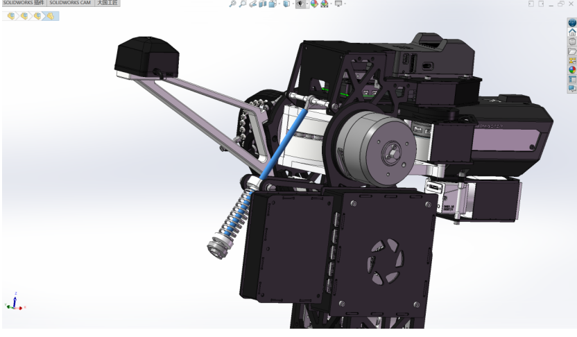

前文提到了实车于理论存在误差，而为了解决这个问题呢野狼战队提出了一个可调节式的思路

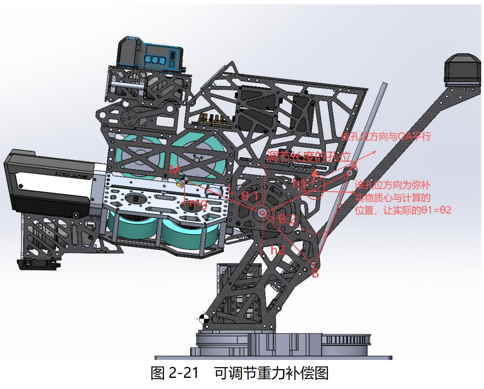

也就是l2并不完全固定，他们制作了多个固定孔位，然后根据实际情况去选择不同的安装孔位来改变l2长度，从而改变k值，去适应你所买的弹簧k值

最后，因为弹簧重补跟质量和质心的关系很大，所以不要用打印件去测试，正常来讲误差会很大，最好在换成机加件后，单独还要对pitch的质量进行称量，对比一下建模参数

参考开源：

华南虎25英雄：https://bbs.robomaster.com/article/803686?source=4

广工重补：

https://bbs.robomaster.com/article/8561?source=4‘

野狼26英雄：

https://bbs.robomaster.com/article/1970325?source=4

这一篇的含金量很高，还有很大设计理论知识，非常建议阅读
