# 庆园阁过洞步兵机械设计技术传承手册

版本 1.0    整理日期 2026年11月23日

本手册用于机械组方案交接、新队员学习，以及机械与电控的接口沟通。内容覆盖整车布局、折叠双俯仰云台、轴系、四连杆、底盘轮组、悬挂、供弹和装配验证。接手设计时，应同时查阅当前三维装配、零件图、标准件清单和试验记录。

当前设计记录形成了折叠双俯仰云台、独立弹舱和侧供弹的实施方向。底盘由早期全向轮方案逐步转向舵轮评估，并围绕100 mm轮径、单侧竖直导向悬挂和快拆安装继续优化。若某项仅完成几何建模，后续仍需完成受力、装配和实车验证。

### 阅读导航

1 项目需求与参数状态

2 设计流程与整车布局

3 电机与轴系的设计方法

4 Yaw轴与同步带传动

5 大俯仰折叠与小俯仰四连杆

6 底盘轮组与性能估算

7 悬挂与车架连接

8 车架刚度与截面惯性矩

9 弹舱 供弹与硬件布置

10 摩擦轮研究与发射验证

11 加工 装配与验证交接

12 方案演变与资料出处

使用时先核对第1章的参数状态，再阅读所接手模块。第11章给出应优先补齐的验证，第12章保留方案演变和资料出处。

## 1 项目需求与参数状态

整车需要在正常作战、俯仰极限、折叠过洞、悬挂压缩与伸长、失能停机等状态下满足几何和功能要求。尺寸约束应绑定到明确姿态，避免把折叠状态的限制错误用于展开状态。

| 项目 | 当前记录 | 使用条件与后续确认 |
|---|---|---|
| 车体平面包络 | 600 × 600 mm | 作为项目设计输入。检查对应赛项、姿态及突出部件的规则要求。 |
| 折叠过洞高度 | 250 mm | 针对折叠通过状态核对，包含线束、外壳和避震工作高度。 |
| 弹舱容量 | 可用弹量不少于450发 | 属于性能目标，需通过实装和连续供弹确认。 |
| 小俯仰工作范围 | 目标 −15° 至 +35° | 早期俯角约−10°。当前范围的全行程干涉和负载试验仍需确认。 |
| 大俯仰折叠范围 | 记录提出折叠角至少32° | 需要在图纸明确零位、正方向及角度参考，防止口头角度混用。 |
| 驱动电机 | 原装M3508为当前计算基准 | 两个俯仰轴的4310、发射电机3508均有经验选型成分，需逐项校核。 |
| 车轮 | 100 mm为几何优化候选 | 相对115 mm有高度与驱动力变化，可靠性和抓地效果待实测。 |
| 悬挂 | 由双侧支撑改为单侧竖直导向方案 | 文件标注已解决的内容主要是结构方案，载荷与寿命仍需验证。 |
| Yaw轴承 | RAU8008 | 按实际供应商完整型号、游隙或预紧等级及安装图确认。 |
| Yaw同步带 | 5M 60齿 中心距120 mm 带长540 mm | 两只带轮齿数、9 mm尺寸的含义和张紧调节量需要在BOM明确。 |

记录中的“已解决”应对应具体成果。例如干涉在当前模型中消除，可以记录为几何问题已处理；强度、装配和连续运行分别附上对应证据。最终采购与加工采用经确认的图纸和标准件资料。

## 2 设计流程与整车布局

### 先确定运动和接口再做零件

推荐的设计顺序为需求分解、模块选择、包络布局、标准件预选、运动校核、详细设计和样机验证。标准件至少先确定可选尺寸范围，再冻结轴系和侧板尺寸。9月记录中，轴承选型晚于尺寸布置，曾造成模型返工。

- 需求分解要给出动作、速度、范围和使用条件。过洞、瞄准、供弹、快拆分别列出能检查的要求。
- 包络布局使用电机、轴承、弹链弯管、小电脑、电调及连接器的真实外形，保留插拔和工具空间。
- 统一车体坐标、各回转轴线、折叠零位和模块接口基准。机械与电控共用这些定义。
- 详细设计后复查受力路径、公差、紧固、限位和拆装顺序。设计改动应回到相关包络重新检查。

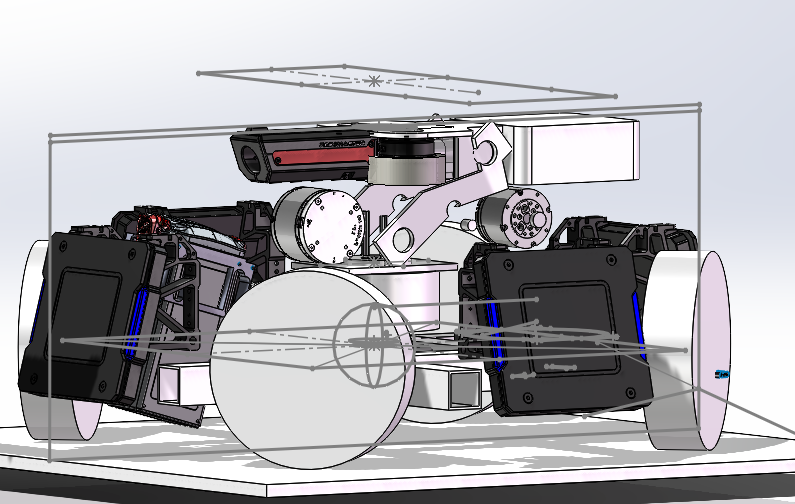

*图 1  9月14日的整车布局参考 主要用于理解折叠云台与底盘的空间关系*

### 整车运动状态的检查顺序

先在额定满载位置检查Yaw全周和小俯仰全范围，再让大俯仰完成折叠与展开。随后分别把悬挂置于压缩端、正常位置和伸长端重复检查。模型检查应包含弹链、滑环线、控制板接插件及外壳的实际包络。

| 检查状态 | 重点位置 |
|---|---|
| 正常作战与Yaw转动 | 枪口视野 小电脑 电调 供弹弯管 装甲板和固定螺栓 |
| 小俯仰极限 | 电机外壳 连杆铰点 枪口与舵向模块 |
| 大俯仰折叠与展开 | 摩擦轮与侧板 连杆与电机 弹链弯曲空间 |
| 悬挂全行程 | 轮组与车架 相机视野 外壳离地高度 线缆余量 |
| 失能与人工搬运 | 静态限位 折叠机构保持方式 外壳和易碰件 |

### 俯角与近距离击打的方案比较

底盘分析记录显示，早期约−10°俯角方案在特定几何模型中，命中参考装甲板中心的最小水平距离约为580 mm。改用100 mm轮子并缩短轮子至舵向模块的竖直距离后，约−15°方案得到约314 mm。两个数字用于比较所建模型的几何可达性，射击效果还需结合实际枪口高度、弹道及目标姿态验证。

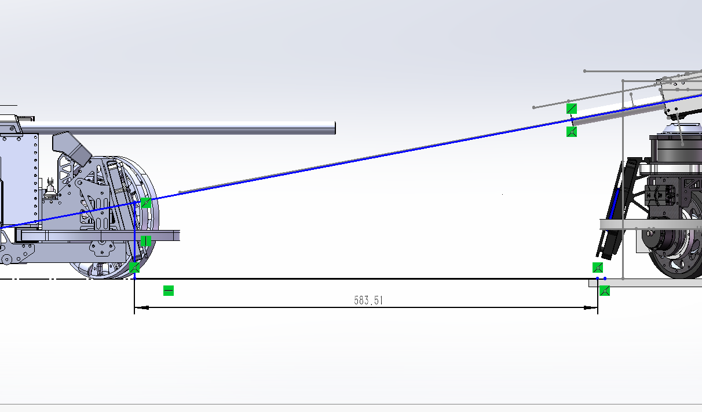

*图 2  早期俯角约−10°的几何可达性模型 原图标注约583.5 mm*

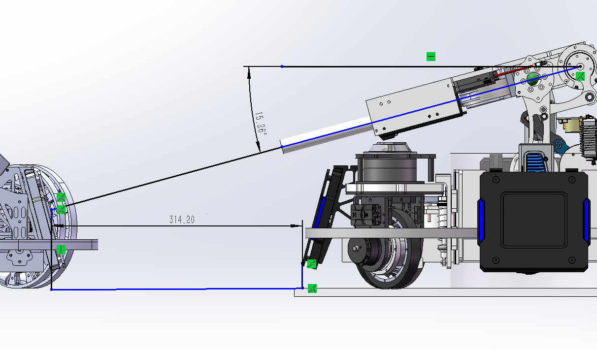

*图 3  轮径与轮组高度优化后的约−15°方案 原图标注约314.2 mm*

## 3 电机与轴系的设计方法

### 从负载运动需求计算

电机选型从负载需要的角速度、角加速度、转动惯量和持续时间开始。转动惯量应以实际回转轴线为基准导出，并包含随动电机、连接件、弹链及满载弹丸等随动质量。

$$
\text{T负载 = Jα + T重力 + T摩擦 + T其他}
$$

其中J为负载绕该轴的转动惯量，α为角加速度。俯仰轴应随姿态计算重力矩；竖直Yaw轴的偏心重力主要给支承带来倾覆载荷，Yaw驱动扭矩另计加速、摩擦和线缆拖曳等项。

$$
\text{n负载 = }\frac{60\omega}{2\pi}
$$

$$
\text{n电机 = i n负载}
$$

$$
\text{T电机需求 = }\frac{\text{T负载}}{i\eta}
$$

减速比i定义为输入转速除以输出转速，η为相应传动效率。上式用于定传动比机构；四连杆应按各姿态的传动关系换算。输出扭矩与输出转速需要在同一工作点同时满足要求。[3]

原记录使用1.5作为选型余量示例。具体余量还应结合冲击、不确定性、温升和动作频次确定，并分别检查峰值能力与持续工作能力。电机型号按经验预选后，应把计算和工作范围曲线补齐。

### 定位和预紧分别设计

轴向定位解决零件沿轴移动的问题，径向配合解决轴与座孔的配合问题。轴承内部游隙或预紧则影响轴承本身的受力和转动阻力。轴肩加压盖固定住一个套圈，并不能直接说明滚动体已获得合适预紧。[4][5]

- 内外圈分别确定轴向定位、径向配合与装配方向，标出哪个零件固定、哪个零件转动。
- 装配力应作用在被安装的套圈上。压盖逐步、均匀锁紧后检查转动阻力和间隙，避免夹住相对转动的两侧。
- 多支点或双导轨结构要核对同轴度、平行度和高度差。重复约束会让装配误差转化为额外载荷。
- 轴系零件完成后，按实际工具路径做一次拆装推演，检查沉头螺钉、卡簧和被遮挡的压板是否能拆下。

## 4 Yaw轴与同步带传动

### 当前结构和受力路径

9月18日至20日的方案采用同步带驱动Yaw，使用RAU8008交叉滚子轴承，并将轴承外圈上压板与云台承接板一体化，以减少零件和装配步骤。该承接板的强度与刚度校核在原记录中仍是后续任务。

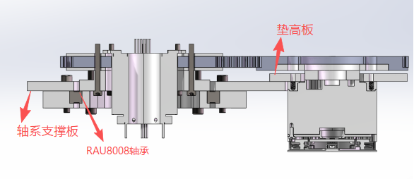

*图 4  9月20日Yaw轴剖面 轴承压板与云台承接板一体化*

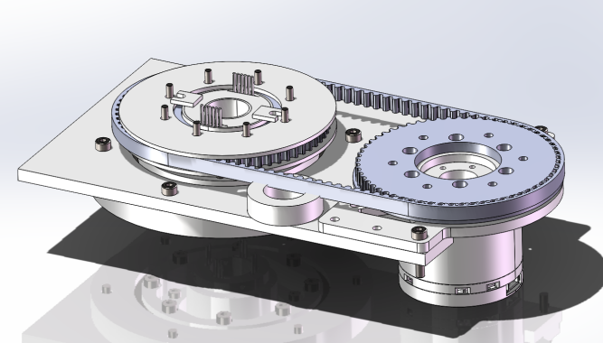

*图 5  9月20日Yaw同步带及回转支承装配方案*

云台自重、横向惯性载荷和云台折叠引起的偏心载荷，经承接板、回转轴承和轴承座传至车架。电机经同步带提供转向扭矩。支承是否稳定，需要同时检查轴承、轴承座、压板、螺栓和车架连接。

$$
\text{M倾覆 = Fh M偏心重力 = mge}
$$

h为水平力作用线到相应支承参考位置的垂直距离，e为重力作用线到支承中心的水平偏距。倾覆力矩使轴系绕水平轴倾斜，Yaw转向则绕竖直轴旋转。两类载荷应分别列出。

### 带轮规格与张紧

原记录给出5M、60齿、中心距120 mm和带长540 mm。若两只带轮均为60齿，带轮节圆直径约95.49 mm，等径两轮的带节线长度为2×120＋60×5＝540 mm，参数可以相互对应。若另一只带轮齿数不同，需重新计算。原记“9 mm高”应在采购清单中明确是否指带宽。

$$
\text{d节圆 = }\frac{zp}{\pi}
$$

改变中心距张紧可采用滑动电机座配长圆孔，再用顶丝细调；空间紧凑时也可采用偏心安装座。滑动座应有导向面，调整时保持两轴平行、带轮共面，调整后由紧固件锁住工作位置。调节范围应覆盖装带和张紧需求，具体张力按带型、宽度和供应商要求确定。

### 设计检查

- 带轮、轴承座和承接板使用共同基准，避免把张紧调整变成带轮歪斜。
- 预留同步带拆装路径。轴承紧固件与带轮紧固件分别可达。
- 检查承接板一体化后，螺钉孔、薄弱截面和电机悬置部分的弯曲变形。
- 记录空载和满载转动阻力、急停后的间隙与晃动，以及连续转向后的温升。

## 5 大俯仰折叠与小俯仰四连杆

### 大俯仰的方案演变

早期比较过四连杆与齿轮两种折叠方案。9月23日发现连杆传动角偏小，且折叠后与电机、计算单元的空间冲突明显，因此考虑过齿轮传动及其他电机。后续继续修改四连杆尺寸，重点围绕电机包络、折叠角和铰点位置进行取舍。

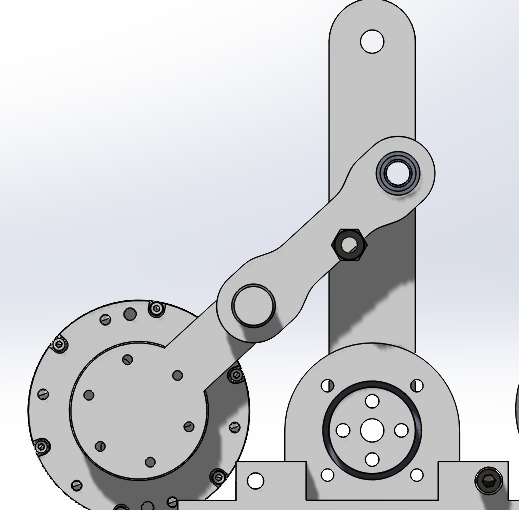

*图 6  10月1日的大俯仰折叠连杆方案 端位锁止需另行验证*

10月1日记录把折叠端位描述为“到死点自锁”。传承时应将其列为需要验证的端位保持方案。理论共线位置对加工误差、间隙和外部冲击敏感，还可能造成控制困难。若利用过中心保持，应把过中心量、机械限位、力的方向、解锁方式和失能行为一起设计，避免把理想死点直接作为可靠锁止结论。

### 过弹侧轴系和狭小装配空间

原方案选用6704尺寸范围的薄壁轴承以缩小轴系外形，并在内部保留过弹通道。6704名义内径为20 mm；原需求写作“孔径大于20 mm”，两者需要在图纸中统一。轴承内径与安装套管内部的通道净径应分别标注，弹丸公差、弯管连接和轴向紧固件都应计入通道检查。[6]

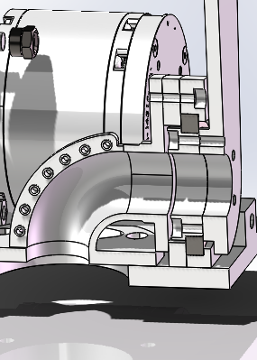

*图 7  10月2日过弹侧轴系 沉头孔与压板空间是重点检查位置*

10月9日比较了“内圈轴肩加卡簧”和“内外圈均使用轴肩加压板”的方案。前者便于拆装，后者便于建立明确的夹紧路径。最终选择应结合轴承类型、实际游隙要求和装配空间，不能把螺栓拧紧直接等同于合适的轴承预紧。卡簧槽必须按选用卡簧的尺寸、倒角和安装空间完成，而非只画出一个环槽。

### 小俯仰采用随动电机的四连杆

为说明运动关系，将四个铰点依次命名为A、B、C、D，其中A与D固定在机架上。小俯仰参考结构把电机定子固定在运动杆AB，转子固定在相邻连杆BC，CD为另一运动杆，机架为AD。电机位于运动铰点B，定子随AB一起运动。这里可以用“定子随动的关节驱动四连杆”描述结构，便于机械与电控统一理解。

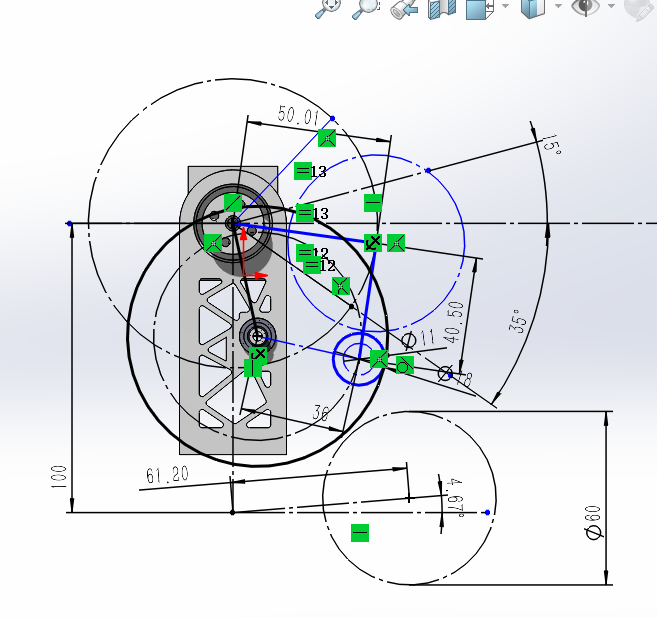

*图 8  10月9日四连杆几何草图 用于检查电机包络与全行程轨迹*

$$
\text{q电机 = θBC − θAB + q零位}
$$

θBC与θAB应使用同一固定参考方向和同一正方向。电机编码器测得的是转子相对定子的角度，云台目标则是相对车体或地面的姿态，两者需要用机构几何和零位标定对应。直接把编码器角度当作云台绝对角度会造成控制定义错误。

电机给BC和AB施加一对方向相反的力矩，四连杆的闭环约束决定各杆之间的运动关系。设计时应在全部工作范围检查角度映射是否连续、是否接近奇异位置、驱动扭矩是否足够，以及铰点间隙是否会放大到枪口。

- 把电机定子、转子、各杆和机架分别设成清晰的刚体，保留实际电机与连接螺钉包络。
- 同时检查俯角、仰角、大俯仰折叠过程和Yaw转动，不能只验证几个孤立端点。
- 传动角可作为几何筛选指标，具体评价需结合电机所在关节及负载所在杆。
- 交给电控的资料包括铰点坐标、杆长、装配分支、角度零位、软硬限位、输出角与电机角映射。

## 6 底盘轮组与性能估算

### 对抗中的性能目标

本项目的底盘评估优先关注满载短距离平移、急停和换向。最高速度与场地转场需求配合评估。对舵轮，应分别测试四轮已对准目标方向时的起步，以及由其他舵角切换后再起步，分清驱动能力和舵向响应。

### 统一转速和扭矩的参考端

原装M3508减速比为3591／187，约19.20。官方在24 V、C620和规定散热条件下给出输出轴空载转速482 rpm、最大持续扭矩3 N·m。若使用这些输出轴参数直接驱动车轮，计算时不再重复乘除原装减速比。若改用转子参数，则必须加入完整传动比。[3]

$$
v =\frac{\text{πDn轮轴}}{60}
$$

$$
\text{F单轮 = }\frac{\text{T轮轴}}{r}
$$

$$
\text{a扭矩 = }\frac{\text{ΣF驱动 − F阻力}}{m}
$$

以下为20 kg、四轮同向驱动的方案比较，忽略行驶阻力、轮组转动惯量和轮胎打滑。3 N·m是原装减速箱额定输出扭矩基准。改箱数值按相同转子转速、相同转子扭矩且效率相近换算，实际减速箱的额定能力需要另查。

| 方案 | 理论空载线速度 m/s | 单轮驱动力 N | 理想加速度 m/s² |
|---|---|---|---|
| 115 mm 原装箱 | 2.90 | 52.2 | 10.43 |
| 100 mm 原装箱 | 2.52 | 60.0 | 12.00 |
| 100 mm 268∶17箱 | 3.07 | 49.3 | 9.85 |

100 mm原装方案的计算为单轮3／0.05＝60 N，四轮共240 N，除以20 kg得到12 m/s²。这个结果只说明扭矩对应的理想能力，实车还需检查抓地、功率限制、供电和控制。

$$
\text{a附着上限 ≈ μg}
$$

仅在水平地面、四轮接地且驱动力分配合理等条件下，可用上式估算附着上限。μ假设为0.6、0.7、0.8时，对应约5.89、6.87、7.85 m/s²。这些系数是计算示例，地胶型号本身不足以给出轮胎附着系数，需要用所选胎料在实际场地测试。

### 轮径 轮宽和轮组位置

115 mm改为100 mm且减速比不变时，同样轮轴扭矩下驱动力增加15%，同样轮轴转速下线速度降低约13%。若其他结构相对轮轴保持原位，且轮组最高点由上方支架或电机决定，则从地面到轮组顶部的高度减少7.5 mm。

轮宽主要影响接地形变、实际抓地表现、转舵阻力和轮组惯量。平胎加宽可能让原地转舵更费力，抓地改善程度应实测。比较轮宽时保持胎料、硬度、包胶厚度和载荷等条件一致。

$$
\text{ω底盘最高 ≈ }\frac{\text{v轮最高}}{\text{R轮组}}
$$

R轮组是轮组回转中心到整车自转中心的平面距离。缩小轮组间距可以提高相同轮速下的理论自转角速度。自转起停还需比较驱动力力臂与整车转动惯量；稳定性则需结合实际轮胎支撑边界和重心高度评估。

## 7 悬挂与车架连接

### 从双侧支撑改为单侧支撑

10月26日记录采用双侧滑轨配弹簧的竖向避震，并在竖直方管的螺栓夹紧处加入垫块。后续底盘分析为腾出弹舱和装甲板空间、减少零件，改为单侧支撑方案，通过加工件连接方管、增加不同方向的安装面，并把滑块与轮组之间的连接集中到一个零件。

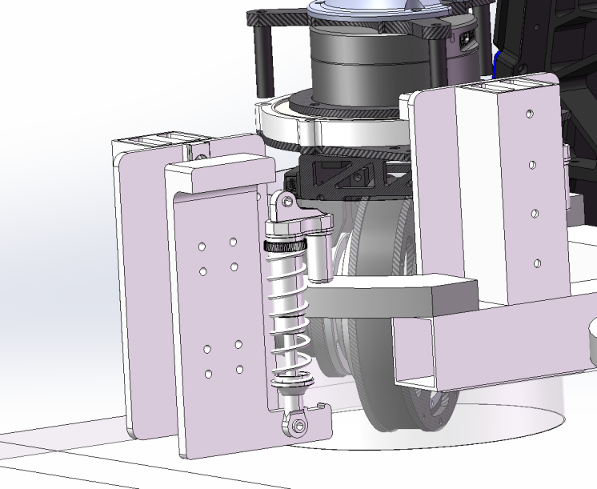

*图 9  旧版悬挂安装参考 原记录认为车架连接处需加强*

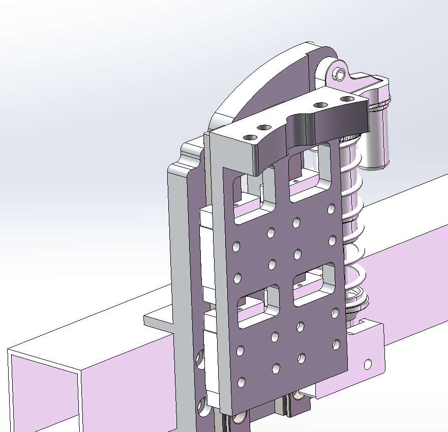

*图 10  后续单侧竖直导向与一体连接件方案 几何完成后仍需验证受力与装配*

选择单侧或双侧的依据是受力和空间。单侧结构需要重点检查支架悬臂弯曲、方管扭转和紧固面的局部变形。双侧导向需要重点控制安装平行度和高度差，避免多余约束导致滑动卡滞。

### 明确轮组载荷由谁承受

地面的竖直支撑力、沿滚动方向的驱动与制动力、沿轮轴方向的侧向力，首先作用于轮胎接触区域，再经轮毂、轮轴支承、支架、舵向回转支承和悬挂连接传至车架。装甲等部件直接受撞时，其载荷从实际接触位置进入结构。

独立回转支承应建立明确的承重路径，舵向电机负责提供转向扭矩。若轮组仍通过刚性连接压在电机轴上，电机内部轴承可能分担载荷。是否承重由具体装配与刚度决定。

地面水平力对上部支承的倾覆力矩可简化为M＝Fh。减小合理范围内的支承高度可以减小力臂；改善配合和锁紧能减少晃动与冲击。轴承内部游隙、轴承座配合间隙以及支架弹性变形应分别处理。[4][5]

### 避震工作位置与行程

- 满载静止时保留压缩和伸长余量，轮子经过局部凸起、凹处时能跟随地面。
- 弹簧刚度、预紧和阻尼分别记录。压下后应较快稳定，反复弹跳或回弹过慢都需要调整。
- 导轨或连杆承担导向与侧向载荷。避震器尽量沿自身轴线受力，并保留活动接头所需自由度。
- 压缩端和伸长端均设明确限位，检查轮组全周转向时的干涉、线束弯曲和外壳离地间隙。
- 将100 mm轮径、轮组高度、悬挂工作位置和过洞高度一起校核。增加悬挂行程会改变可用包络。

### 井字车架的板材螺栓节点

连接板要把交叉梁的相对滑动、转动和翘起控制在允许范围。优先沿梁方向布置有间距的螺栓组，并保留孔与板边、减重孔之间的净截面。连接板要与各梁真实贴合，错层位置采用相应台阶或支撑。

薄壁方管直接攻丝时检查有效啮合长度与脱扣；长螺栓贯穿夹紧时，通过合适的压缩套筒或内衬建立夹紧路径，防止管壁被压凹。碳板连接处用合适的垫圈或压板分散压力，控制预紧并检查分层。具体螺栓规格和锁紧扭矩随材料与连接形式校核。[7][8]

## 8 车架刚度与截面惯性矩

车架刚度表示受载后抵抗变形的能力。梁在特定方向的抗弯刚度与EI有关，整副车架还受跨度、节点连接、支撑位置、孔槽和载荷路径影响。对同一材料、同一尺寸的梁，改变它的离地高度并不能直接改变其自身形心轴截面惯性矩。

$$
\text{I参考轴 = I形心轴 + A}d^{2}
$$

d是截面形心轴到所选平行参考轴的垂直距离。使用平行轴定理前，先画出所取截面与参考轴。

### 30毫米方管的指定截面示例

$$
\text{I单管 = }\frac{{30}^{4}-{27}^{4}}{12}= 23 213.25{mm}^{4}
$$

以上按30×30×1.5 mm均匀方管计算，忽略圆角、孔和槽。取两根平行主梁中段、避开横梁交叉点的截面S，比较竖向弯曲。上下堆叠架在这里仅截到两根上层主梁，共面架也仅截到两根主梁。

| 比较项 | 上下交叉堆叠架 | 共面拼接架 |
|---|---|---|
| 示例总高度 | 60 mm | 30 mm |
| 截面S包含的主梁 | 2根 | 2根 |
| 各自车架最低点为零时的中性线高度 | 45 mm | 15 mm |
| 指定截面S的竖向弯曲惯性矩 | 46 426.5 mm⁴ | 46 426.5 mm⁴ |

这个结果只适用于指定截面。互相垂直的上下梁不能直接按上下平行的共同承载梁计算。若要比较整架，应施加相同的轮组支撑、云台重量及单轮顶起等载荷，比较关键点位移、连接转角和整架扭转。

### 分析结果与试验对应

有限元模型需要体现真实连接。螺栓连接若全部设为完全粘结，可能高估节点刚度。记录材料、网格、约束、接触假设和载荷位置，再用样架测量检查趋势。重点观察轮组安装面、Yaw承接板和交叉节点，避免只根据最大应力云图判断整体性能。

## 9 弹舱 供弹与硬件布置

### 容量目标与可用弹量

底盘文件提出弹舱可用容量不少于450发，且需要牢固、方便连接和快拆。现有平面范围内容量不足，可通过调整舱高或释放底盘平面空间解决，但需要同时检查折叠云台、侧供弹弯管和硬件包络。

原记录内腔示例为220×127×85 mm，容积约2.375 L。直径17 mm球体体积约2.572 cm³。用可用容积V和装填率η作体积估算时，可用下式。

$$
\text{N估算 ≈ }\frac{\text{ηV可用}}{\pi d^{3}\text{／6}}
$$

原稿给出的460至490发估计约对应0.50至0.53的有效装填比例。此处仍应作为粗估保留，实际舱内的隔板、拨弹机构、坡面、出弹口死区和舱盖都会改变可用容量。验收应统计能连续送出的弹数，而不只统计人工塞入舱内的数量。

### 供弹方案与接口

早期曾比较中心供弹与侧供弹。侧供弹有利于按当前折叠方案分离弹舱与云台，但会增加弹链长度和布置复杂度。中心供弹的结构紧凑性和潜在供弹问题，应随具体机构验证，不能把交流中的个例概括为某类供弹必然更稳定。

重点检查弯管与滑环线干涉、折叠时的弯曲与连接角度、接口内台阶和通道净径。大俯仰两侧增加限位时，应把弹链在极限姿态的受力一起纳入。

### 硬件与外壳

现有布置思路为电池与电调集线板相邻、超电单独安排、分电板与主控集中布置。云台还需落实主板和两个电调的位置。固定件应同时保留接插件插拔、散热、线束弯曲和螺钉拆装空间。

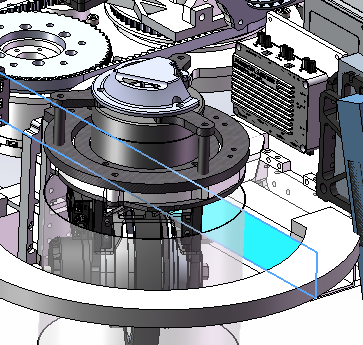

*图 11  底盘侧边铝排与外壳安装空间参考*

外壳优先围绕转动包络分区，再确定快拆接口。可使用车架侧边铝排建立安装点。电池、控制板或供弹快拆时，应能按预定顺序移出，避免拆一个模块必须先拆整副云台。

## 10 摩擦轮研究与发射验证

### 把命中问题拆成可测量的量

10月12日记录整理了关于摩擦轮惯量、包胶、温度和弹丸公差的学习内容。这部分保留为研究依据和试验问题。正式比较时，统一靶面水平与竖直坐标，分别记录初速度、散布、连续射击掉速和温升，避免把落点远近或左右误差归结为单一原因。

### 惯量与入射速度敏感性

原笔记用线性滑块共速模型讨论入射速度对最终速度的影响，在该假设下得到速度扰动比例m／(M＋m)。其中M是等效质量，m是弹丸质量。这种简化有助于理解惯量对掉速与速度扰动的影响。实际摩擦轮还存在滑移、橡胶变形和电机补能，需结合试验。

$$
\text{Δv共速 = }\frac{m}{\text{M等效 + m}}\text{ Δv入射}
$$

$$
\text{M等效 ≈ Σ}\frac{\text{J轮}}{{\text{r有效}}^{2}}
$$

增大惯量会改变连续射击时的掉速，同时也增加启动、恢复和调速的负担。选型记录应同时给出轮体惯量、发射频率及电机实际转速响应。

### 包胶和轮间距的试验方向

| 变量 | 关注的现象 | 建议记录 |
|---|---|---|
| 左右轮间距 | 挤压量不足可能加速不充分，过大挤压也可能增加回弹和负载变化 | 冷态与热态弹速 电流 散布 是否卡弹 |
| 包胶厚度与硬度 | 对弹丸公差的包容 接触形变 磨损与恢复 | 材料批次 硬度 厚度 使用温度 |
| 轮面形状 | 接触路径与自定心趋势 左右对称性 | 轮廓尺寸 跳动 入弹姿态 |
| 轮体惯量 | 连续射击掉速与恢复速度 | 转动惯量 单发与连发转速曲线 |
| 传动与支承 | 轮系跳动和装配误差是否传到轮面 | 轴与端面跳动 联轴器类型 轴承配置 |

原记录把接触压力、摩擦力与加速度描述为抛物线，适合保留为特定简化模型的假设。具体分布与材料、接触几何、滑移和弹丸形变有关，实施参数应通过同一试验条件比较。

### 温度与联轴器的结论边界

温升后弹速变化需要联合测量轮温、实际转速、供电、间距和弹丸批次。原稿中的材料温度表可作为研究线索，其温度范围、材料型号和“弹性”指标应先辨认，再用于推断工作温升下的性能，避免把回弹率直接当作杨氏模量。

“蚊香盘”柔性联轴器用于隔离部分安装偏差和跳动，同时引入自身的扭转柔度。发射轮仍需可靠独立支承和同轴度控制。是否改善散布，应在相同弹丸、转速、间距和热态条件下对比。

## 11 加工 装配与验证交接

### 加工前检查

- 标准件型号完整，电机和轴承的供应商尺寸图与三维模型一致。轴承配合、轴肩、倒角和压盖分别标注。
- 沉头孔、卡簧槽、薄壁螺纹和减重孔周边保留足够材料，紧固件长度与有效啮合对应。
- FDM零件明确材料、打印方向、受力方向和螺纹连接方式。试装件与长期承载件的验证条件分别记录。
- CNC件、碳板、方管和打印件交界面贴合，螺栓拧紧后不靠板材被迫弯曲补偿尺寸误差。
- 装配基准、工具空间、模块拆装顺序、线束余量及限位件已落实到模型和图纸。

### 优先处理的未闭环事项

| 事项 | 已有记录 | 下一步应补齐的证据 |
|---|---|---|
| 弹链转角与板材干涉 | 11月22日仍列为问题 | 更新几何并检查全运动范围，留存改前改后对比。 |
| 轴承外压螺母与轴干涉 | 11月22日仍列为问题 | 核对轴向尺寸链和装配顺序，完成实际试装。 |
| 卡簧槽口错误 | 11月22日仍列为问题 | 按卡簧型号重核槽径 槽宽 挡边与安装工具空间。 |
| Yaw一体承接板受力 | 9月20日注明缺少校核 | 补满载重力 偏心 倾覆及急停载荷下的应力与变形。 |
| 四连杆端位保持 | 10月1日提出死点保持 | 确认过中心与限位方案，验证失能 冲击和解锁行为。 |
| 小俯仰与折叠干涉 | 多次通过模型修改 | 以当前完整模型复查角度范围 电机与弹链包络。 |
| 单侧悬挂固定 | 底盘分析中标注方案已解决 | 补刚度 导轨卡滞 轮组定位和载荷下松动检查。 |
| 100 mm轮组性能 | 几何改善但稳定性待确认 | 补满载起步 刹停 转舵 过缝和温升测试。 |
| 弹舱450发目标 | 已有内腔尺寸粗估 | 统计可装弹与可连续供弹数量，并记录剩余死区。 |

### 样机测试与验收记录

每次测试记录样机版本、满载质量、重心估计、轮胎材料、场地、供电电压、限流或功率设置及软件版本。先确认机械运动顺畅，再进行低速动作，逐步扩大到工作范围。试验前由车组填写允许间隙、动作时间、温升及重复次数等验收值。

| 测试项目 | 记录内容 |
|---|---|
| 满载起步与急停 | 车身实际位移 时间 刹停距离 轮胎空转情况与电机电流 |
| 舵向换向 | 轮子已对准与未对准两种起步用时 舵向电流与振荡 |
| 悬挂与车架 | 单轮顶起时的贴地情况 四轮安装面变化 节点松动与导向卡滞 |
| 云台与折叠 | 俯仰范围 Yaw全周 折叠时间 限位及失能状态 |
| 供弹与发射 | 可用弹量 连发卡弹 弹速分布 靶面散布 热态变化 |
| 拆装维护 | 电池 弹舱 轮组 轴承和电调能否按预定顺序拆装 |

### 交接资料清单

交接时一并提供完整装配与依赖零件、加工图、BOM和供应商型号、关键尺寸与角度零位、计算表及模型假设、装配顺序、测试原始数据和未解决事项。每项修改记录日期、原因、影响模块和验证结果，避免只留下最终模型而丢失取舍依据。

## 12 方案演变与资料出处

### 关键设计节点

| 时间 | 主要变化与经验 |
|---|---|
| 9月1日至4日 | 比较中心与侧供弹，采用弹舱与云台分离的思路，优先全向轮并保留舵轮适配。 |
| 9月7日至14日 | 完成初步布局与尺寸校核，发现标准件包络 折叠状态及小电脑干涉对方案的约束。 |
| 9月15日至20日 | 明确轴系受力和电机选型流程，形成Yaw同步带与一体承接板方案。 |
| 9月21日至28日 | 设计过弹侧轴系，比较大俯仰四连杆与齿轮方案，处理传动角和空间冲突。 |
| 9月30日至10月2日 | 修改折叠连杆并提出端位保持，暴露沉头孔与轴承压板空间问题。 |
| 10月4日至11日 | 明确定子随动的四连杆关系，继续调整俯仰范围并重申自上而下设计。 |
| 10月12日 | 整理摩擦轮的惯量 间距 包胶和温升研究问题，后续需以试验闭环。 |
| 10月26日及后续底盘分析 | 由双侧竖直导向向单侧悬挂演变，优化弹舱 装甲及安装空间。 |
| 10月31日 | 明确指定截面惯性矩与整副车架刚度的区别。 |

### 原始记录

[1] 设计记录，内容日期为2026年9月1日至11月22日。各阶段模型、交流图片及摩擦轮学习笔记见原文。

打开设计记录

[2] 底盘设计分析，文件修改日期为2026年11月18日。需求、俯角几何对比、弹舱、单侧悬挂和外壳方案见原文。

打开底盘设计分析

本手册插图取自上述记录，图注中的日期用于识别历史方案。交流参考模型与本队方案应结合原记录辨认，原始记录和后续版本按日期继续保留。

### 标准件与设计参考

[[3] DJI M3508产品参数与使用说明](https://www.robomaster.com/en-US/products/components/detail/1278)

[[4] THK交叉滚子轴承座与压盖设计](https://www.thk.com/eu/en/products/cross_roller_ring/cross_roller_ring/design/0002/)

[[5] THK交叉滚子轴承装配要求](https://www.thk.com/us/en/products/cross_roller_ring/cross_roller_ring/maintenance/0001/)

[[6] NSK 6704系列主要尺寸参考](https://www.nsk.com/content/dam/nsk/common/catalogs/ctrgPdf/bearings/e1258f.pdf)

[[7] Steel Tube Institute空心管贯穿螺栓连接](https://steeltubeinstitute.org/resources/connecting-hollow-structural-section-members-bolts/)

[[8] Nord Lock复合材料紧固连接说明](https://www.nord-lock.com/it-ch/learnings/bolting-tips/2010/the-experts-do-nord-lock-washers-work-with-fibre-composites/)

[[9] THK RAU系列及尺寸资料](https://www.thk.com/sg/en/products/cross_roller_ring/cross_roller_ring/rau/rau_ra/)

参考资料检索日期为2026年11月23日。供应商型号存在差异时，以采购对象的完整型号和正式尺寸图核对；示例厂家参数用于理解和计算，不代替样机验收。
