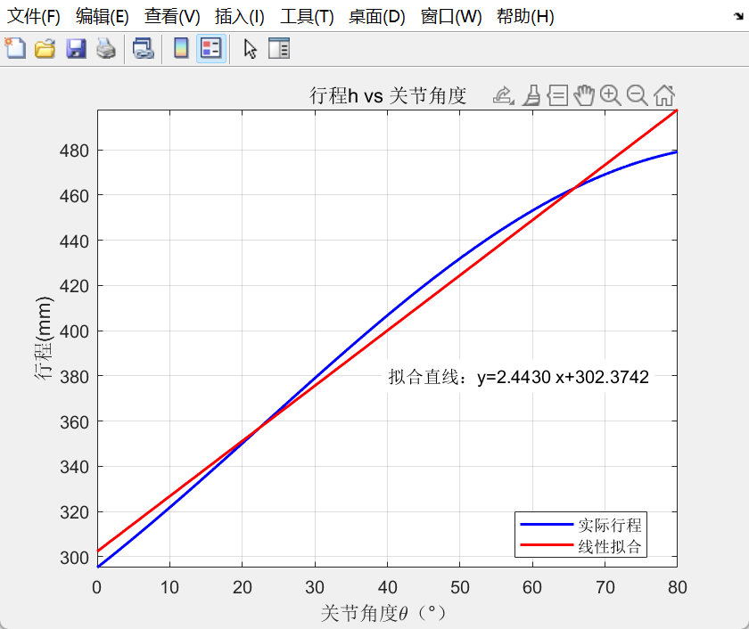

# MATLAB 轮腿机器人计算代码学习日志

## 前言

本日志旨在记录复刻轮腿机器人 MATLAB 计算过程的思考与学习。内容从基础语法到核心算法，力求让初学者也能清晰理解代码的编写思路与内在逻辑。

## 1. 基础语法与编程规范

### 代码注释与分节

- %：单行注释。用于解释某一行代码的作用，不会被程序执行。
- %%：代码分节符。它不仅能注释，还能将代码划分为不同的逻辑区块（或称”节”）。在 MATLAB 编辑器中，你可以独立运行每一个”节”，这对于分步调试和验证非常有用。

### 赋值与等于

- =：赋值操作符。它的作用是将右侧的值或计算结果存入左侧的变量中。例如 A = 4，意为”将 4 这个值赋给变量 A”。
- ==：等于操作符。用于比较左右两侧的值是否相等，返回逻辑值 true（真）或 false（假）。在定义方程时（如 eq1 = ... == ...）必须使用双等号。

### 语句结束

- ;：分号。放在语句末尾有两个作用：
  - 表示该语句结束。
  - 抑制输出。如果不加分号，MATLAB 会在命令行窗口打印出该语句的计算结果；加上分号后，计算照常进行，但结果不会显示，保持命令行窗口整洁。

## 核心代码逻辑解析

- 1.2.3

这部分我们将按照代码的执行顺序，一步步拆解其背后的数学与编程思想。

### 第一步：符号定义与方程建立

```matlab
% 1. 定义符号变量
syms l1 l2 l3 real          % 定义连杆长度为实数符号变量
syms theta1 theta2 real     % 定义关节角度为实数符号变量
syms Cx Cy real             % 定义末端C点坐标为待求解的实数符号变量

% 2. 建立中间点D和E的坐标表达式
Dx = l1*cos(theta1) + l3/2;
Dy = l1*sin(theta1);
Ex = l1*cos(theta2) - l3/2;
Ey = l1*sin(theta2);

% 3. 通过"画圆法"建立关于C点坐标的方程组
% C点到D点的距离为l2，C点到E点的距离也为l2
eq1 = (Cx-Dx)^2 + (Cy-Dy)^2 == l2^2;
eq2 = (Cx-Ex)^2 + (Cy-Ey)^2 == l2^2;
```

思路：首先，我们不代入具体数值，而是用 syms 定义所有相关的物理量为符号变量。这就像在纸上推导公式一样，MATLAB 会帮我们进行符号运算。

- eq：表示方程组，eq1则为方程1，eq2为方程2

关键点：real 关键字确保所有变量都被视为实数，避免在后续计算中出现无物理意义的复数解。

### 第二步：符号求解与雅可比矩阵推导

```matlab
% 1. 求解方程组
sol = solve([eq1, eq2], [Cx, Cy]);
% sol是一个"结构体"，它像一个盒子，里面装着方程组的所有解（Cx和Cy）

% 2. 提取C点坐标的解析解
Cx_sol = real(sol.Cx(1)); % 提取Cx的第一个解，并取其实部
Cy_sol = real(sol.Cy(1)); % 提取Cy的第一个解，并取其实部

% 3. 推导雅可比矩阵 (Jacobian Matrix)
% 雅可比矩阵描述了关节速度(θ1_dot, θ2_dot)与末端速度(Cx_dot, Cy_dot)之间的关系
j11 = diff(Cx_sol, theta1); % Cx对theta1求偏导
j12 = diff(Cx_sol, theta2); % Cx对theta2求偏导
j21 = diff(Cy_sol, theta1); % Cy对theta1求偏导
j22 = diff(Cy_sol, theta2); % Cy对theta2求偏导

j = [j11 j12; j21 j22];     % 组合成2x2的雅可比矩阵
```

- solve 函数：用于求解符号方程组。返回的 sol 是一个结构体，可以通过 sol.Cx 和 sol.Cy 来访问解。由于是二次方程，通常会有两个解，用 (1) 和 (2) 区分。
- real 函数：这是一个重要的数据清洗步骤。在复杂的符号运算中，即使理论结果是实数，计算机也可能产生一个极小的虚部（如 1e-16i）。real() 函数可以剥离这个无意义的虚部，确保后续计算的稳定性。
- diff 函数：用于求偏导数，是推导机器人速度、力雅可比矩阵的核心工具。

### 第三步：代入数值与物理解筛选

```matlab
% 1. 设定具体的物理参数 (变量名后加 _val 以示区分)
l1_val = 0.1;     % m
l2_val = 0.15;    % m
l3_val = 0;       % m
a_ang = 50;       % 度
b_ang = 50;       % 度
theta1_val = deg2rad(180 - a_ang); % 角度转弧度
theta2_val = deg2rad(b_ang);       % 角度转弧度

% 2. 将物理参数代入符号解，计算出两组可能的C点坐标数值
Cx_num_1 = double(subs(Cx_sol, [l1,l2,l3,theta1,theta2], [l1_val,l2_val,l3_val,theta1_val,theta2_val]));
Cy_num_1 = double(subs(Cy_sol, [l1,l2,l3,theta1,theta2], [l1_val,l2_val,l3_val,theta1_val,theta2_val]));
% ... (同样计算 Cx_num_2, Cy_num_2)

% 3. 根据物理约束，选择正确的解
if Cy_num_1 > Cy_num_2 && Cy_num_1 > 0
    % 选择y坐标更大且为正的解，这对应于机器人"膝盖"朝上的正常构型
    Cx_final = Cx_num_1;
    Cy_final = Cy_num_1;
    fprintf('C点坐标为: x = %.2f, y = %.5f\n', Cx_final, Cy_final);
else
    % 另一组解对应"膝盖"朝下的奇异构型，在此场景下舍去
    fprintf('C点选点异常，请检查参数。\n');
end
```

- subs 函数：subs(表达式, 旧变量, 新变量)，作用是将表达式中的符号变量替换为具体的数值。
- double 函数：将符号计算结果转换为双精度浮点数。这是进行数值比较（如 if 判断）和后续高效数值计算所必需的步骤。

if 逻辑判断：由于几何求解的特性，通常会得到两个数学上成立的解。我们需要根据机器人的实际物理结构（例如，五连杆机构通常只有一种”膝盖朝上”的稳定构型）来编写逻辑，筛选出唯一正确的物理解。在if句式写完后，一定要加end来表示该语句完结

### 第四步：数值计算与结果输出

```matlab
% 1. 计算特定姿态下的雅可比矩阵数值
j_num = subs(j, [l1,l2,l3], [l1_val,l2_val,l3_val]);
j_final = double(subs(j_num, [theta1,theta2], [theta1_val,theta2_val]));

% 2. 计算关节扭矩
F = [0; m*g/2];        % 末端受力向量 (假设承受一半重力)
tau_final = j_final' * F; % 关节扭矩 = 雅可比矩阵的转置 * 末端力

% 3. 格式化输出结果
fprintf('A点的关节角度为%.f度，B点的关节角度为%.f度\n',a,ang,b_ang);
disp('=== 并联五连杆雅可比矩阵 ===');
disp('j=');
disp(j_final);         % disp适合直接打印矩阵或简单文本

disp('=== 并联五连杆关节扭矩 ===');
% fprintf适合格式化输出，如控制小数位数
fprintf('τ1 = %.2f N*m (%.2f N*mm)\n', tau_final(1),tau_final_mm(1));
fprintf('τ2 = %.2f N*m (%.2f N*mm)\n\n', tau_final(2) tau_final_mm(2));
```

- disp vs fprintf：
  - disp(变量)：简单直接，适合快速查看矩阵或变量的值，自动换行，能自动对齐矩阵。但无法控制小数位数。
  - fprintf('格式字符串', 变量)：功能强大，可以精确控制输出格式。例如 %.2f 表示输出一个浮点数并保留两位小数，\n 表示换行。

完整代码展示：

```matlab
%% 并联五连杆模型求末端执行器点C的坐标
% 先列出名词定义
syms l1 l2 l3 real %均为连杆长度，设为已知
syms theta1 theta2 real %均为关节电机的关节角度，设为已知
syms Cx Cy real %末端C点坐标，为未知量
Dx=l1*cos(theta1)+l3/2;
Dy=l1*sin(theta1);
Ex=l1*cos(theta2)-l3/2;
Ey=l1*sin(theta2);
%通过画圆法得出有关C点坐标方程组
eq1=(Cx-Dx)^2+(Cy-Dy)^2==l2^2;
eq2=(Cx-Ex)^2+(Cy-Ey)^2==l2^2;
sol=solve([eq1,eq2], [Cx,Cy]);
%% 选择物理可行的解
Cx_sol=real(sol.Cx(1));
Cy_sol=real(sol.Cy(1));

% 五连杆模型求雅可比矩阵
%% 对theta1和theta2求偏导，得到雅可比矩阵

% Cx对theta1和theta2的偏导
j11=diff(Cx_sol,theta1);
j12=diff(Cx_sol,theta2);

%Cy对theta1和theta2的偏导
j21=diff(Cy_sol,theta2);
j22=diff(Cy_sol,theta1);

j=[j11 j12;j21 j22];

%%设置实际物理参数
m=15; %机器人质量（kg），即除去腿部和驱动轮后的质量
g=9.81; %重力加速度
%连杆长度
l1_val=0.1; %m
l2_val=0.15; %m
l3_val=0; %m
%关节角度
a_ang=50; %度
b_ang=50; %度
theta1_val=deg2rad(180-a_ang) ;
theta2_val=deg2rad(b_ang);

%代入计算C点坐标
Cy_num_1=subs(sol.Cy(1),[l1,l2,l3,theta1,theta2],[l1_val,l2_val,l3_val,theta1_val,theta2_val]);
Cy_num_2=subs(sol.Cy(2),[l1,l2,l3,theta1,theta2],[l1_val,l2_val,l3_val,theta1_val,theta2_val]);
Cx_num_1=subs(sol.Cx(1),[l1,l2,l3,theta1,theta2],[l1_val,l2_val,l3_val,theta1_val,theta2_val]);
Cx_num_2=subs(sol.Cx(2),[l1,l2,l3,theta1,theta2],[l1_val,l2_val,l3_val,theta1_val,theta2_val]);
if Cy_num_1>Cy_num_2 && Cy_num_1>0
    fprintf('%.2f,%.2f',Cx_num_1,Cx_num_2);
    fprintf('C点坐标的x为%.2f\n',Cx_num_1);
    fprintf('%.2f,%.2f',Cy_num_1,Cy_num_2);
    fprintf('C点坐标的y为%.5f\n',Cy_num_1);
else
    fprintf('C点选点异常，请查看值\n');
end

%%雅可比矩阵的计算
j_num=subs(j,[l1,l2,l3],[l1_val,l2_val,l3_val]);
j_final=double(subs(j_num,[theta1,theta2],[theta1_val,theta2_val]));
%Dx_num=subs(Dx,[l1,theta1],[l1_val.theta_val]);

%%关节负载计算
F=[0;m*g/2]; %由受力分析可得，地面反作用力单位为N
tau_final=j_final'*F; %关节扭矩单位为N/m
%将扭矩转换为N*mm（1N*m=1000N*mm）
tau_final_mm=tau_final*1000;
fprintf('A点的关节角度为%.f度，B点关节角度为%.f度\n',a_ang,b_ang);
disp('===并联五连杆雅可比矩阵===');
disp('j=');
disp(j_final);
disp('===并联五连杆关节扭矩===');
fprintf('τ1=%.2f N*m (%.2f N*mm)\n',tau_final(1),tau_final_mm(1));
fprintf('τ2=%.2f N*m (%.2f N*mm)\n\n',tau_final(2),tau_final_mm(2));
```

1.2.4

本部分代码在前文”正并联构型”的基础上，引入了偏置系数 k，将正并联机构扩展为偏置并联构型，并在此基础上推导了末端执行器点 J 的坐标，进一步利用雅可比矩阵的转置关系，从末端受力反推出各关节电机需要提供的扭矩。。

与前文相比，本部分新增的核心内容包括：

- 偏置系数 k 的引入及其对 D、E 点坐标的影响
- 偏置点 H 的定义
- 基于 CE 与 HJ 比例关系推导 J 点坐标

注意：符号定义、方程建立、solve 求解、real 取实部、subs 代入、double/vpa 类型转换等基础操作，在前文已有详细讲解，本部分不再赘述，仅在涉及新增内容时简要提及。

### 偏置系数 k 的引入与构型变化

```matlab
syms l1 l2 k real %连杆参数
syms theta1 theta2 resl %均为关节电机的关节角度，设为已知
syms Cx Cy real %末端C点坐标，为未知量
Dx=k*l1*cos(theta1);
Dy=k*l1*sin(theta1);
Ex=k*l1*cos(theta2);
Ey=k*l1*sin(theta2);
Hx=l1*cos(theta2);
Hy=l1*sin(theta2);
```

与前文正并联构型相比，D 点和 E 点的坐标表达式中各乘了一个系数 k：

| 点 | 正并联构型（前文） | 偏置并联构型（本部分） |
|---|---|---|
| D 点 | Dx = l1*cos(theta1) | Dx = kl1cos(theta1) |
| E 点 | Ex = l1*cos(theta2) | Ex = kl1cos(theta2) |

物理含义：系数 k（0 < k < 1）控制 D、E 两点沿连杆方向的偏置程度。当 k = 1 时退化为正并联构型；当 k < 1 时，D、E 两点向原点方向收缩，形成偏置效果。

同时新增了 H 点 的定义：

```matlab
Hx = l1*cos(theta2);
Hy = l1*sin(theta2);
```

H 点的坐标与”正并联构型” 中 E 点的原始坐标一致，即 H 点位于第二个连杆末端方向上、距离原点为 l1 的位置。H 点将在后续的 J 点坐标推导中作为参考基准点使用。

- k 被定义为符号变量（syms k real），而非直接赋数值。这样可以在后续推导中保持公式的通用性，最后再通过 subs 代入具体的 k_val 值。
- real 关键字确保 k 被视为实数，避免符号求解时出现无物理意义的复数解。

### C 点方程与求解（沿用前文逻辑）

```matlab
eq1 = (Cx-Dx)^2 + (Cy-Dy)^2 == (k*l2)^2;
eq2 = (Cx-Ex)^2 + (Cy-Ey)^2 == (k*l2)^2;
sol = solve([eq1, eq2], [Cx, Cy]);
```

方程组的建立逻辑与前文完全一致——通过”画圆法”，C 点到 D 点的距离为 kl2，C 点到 E 点的距离也为 kl2。唯一的变化是圆的半径从 l2 变为 k*l2，这是因为 D、E 两点因偏置系数 k 的影响，等效连杆长度也相应缩放。

求解后提取物理可行解：

```matlab
Cx_sol = real(sol.Cx(1));
Cy_sol = real(sol.Cy(1));
```

此处 real() 的作用与前文相同——剥离符号运算中可能产生的极小虚部（如 1e-16i），确保坐标为纯实数。

### J 点坐标的推导（新增内容）

```matlab
syms jx jy real;
jx = Hx + 1/k*(Cx_sol - Ex);
jy = Hy + 1/k*(Cy_sol - Ey);
```

J 点是偏置并联构型中的末端执行器点，其坐标通过 CE 与 HJ 之间的比例关系推导得出。

几何关系：在偏置并联机构中，向量 CE 与向量 HJ 存在平行且成比例的关系。具体而言：

- 向量 CE = (Cx - Ex, Cy - Ey)
- 向量 HJ = (jx - Hx, jy - Hy)
- 比例关系为：HJ = (1/k) * CE

因此：

```matlab
jx = Hx + (1/k) * (Cx - Ex)
jy = Hy + (1/k) * (Cy - Ey)
```

物理意义：偏置系数 k 不仅影响了 D、E 两点的位置，还通过 1/k 的放大关系决定了 J 点相对于 H 点的偏移量。当 k 较小时，1/k 较大，J 点的偏移被放大，这体现了偏置构型对末端执行器位置灵敏度的影响。

### 物理参数设定与数值代入

```matlab
m = 15;           % 机器人质量（kg），即除去腿部和驱动轮后的质量
g = 9.81;         % 重力加速度
l1_val = 0.21;    % m
l2_val = 0.25;    % m
k_val = 0.2;      % 系数 k<1
a_ang = 20;       % 度
b_ang = 30;       % 度
theta1_val = deg2rad(180 - a_ang);
theta2_val = deg2rad(b_ang);
```

### C 点坐标数值计算与解的选择

```matlab
Cy_num_1 = subs(sol.Cy(1), [l1,l2,k,theta1,theta2], [l1_val,l2_val,k_val,theta1_val,theta2_val]);
Cy_num_2 = subs(sol.Cy(2), [l1,l2,k,theta1,theta2], [l1_val,l2_val,k_val,theta1_val,theta2_val]);
Cx_num_1 = subs(sol.Cx(1), [l1,l2,k,theta1,theta2], [l1_val,l2_val,k_val,theta1_val,theta2_val]);
Cx_num_2 = subs(sol.Cx(2), [l1,l2,k,theta1,theta2], [l1_val,l2_val,k_val,theta1_val,theta2_val]);

if Cy_num_1 > Cy_num_2 && Cy_num_1 > 0
    Cy_num = vpa(Cy_num_1);
    Cx_num = vpa(Cx_num_1);
    fprintf('%.2f,%.2f', Cx_num_1, Cx_num_2);
    fprintf('C点坐标的x为%.2f\n', Cx_num_1);
    fprintf('%.2f,%.2f', Cy_num_1, Cy_num_2);
    fprintf('C点坐标的x为%.5f\n', Cy_num_1);
else
    fprintf('C点选点异常，请查看值\n');
end
```

### J 点坐标数值计算

```matlab
x_num = double(subs(jx, [l1,l2,k,theta1,theta2], [l1_val,l2_val,k_val,theta1_val,theta2_val]));
y_num = double(subs(jy, [l1,l2,k,theta1,theta2], [l1_val,l2_val,k_val,theta1_val,theta2_val]));
fprintf('J点的坐标为（%.2f,%.5f）\n', x_num, y_num)
```

### 后续计算

- 后续计算与1.2.3无异，不再赘述

完整代码：

```matlab
%%偏置并联腿的扭矩计算
%先求解末端执行器点C的坐标
%基于坐标系和几何关系
syms l1 l2 l3 real %均为连杆长度，设为已知
syms k %为连杆之间的比例系数
syms theta1 theta2 resl %均为关节电机的关节角度，设为已知
syms Cx Cy real %末端C点坐标，为未知量
Dx=k*l1*cos(theta1);
Dy=k*l1*sin(theta1);
Ex=k*l1*cos(theta2);
Ey=k*l1*sin(theta2);
Hx=l1*cos(theta2);
Hy=l1*sin(theta2);

%通过画圆法列出C点方程
eq1=(Cx-Dx)^2+(Cy-Dy)^2==(k*l2)^2;
eq2=(Cx-Ex)^2+(Cy-Ey)^2==(k*l2)^2;
sol=solve([eq1,eq2],[Cx,Cy]);
%% 选择物理可行的解
Cx_sol=real(sol.Cx(1));
Cy_sol=real(sol.Cy(1));

%%通过偏置并联模型我们可以得知CE和HJ存在比例关系，从而可以推导出末端执行器点J的坐标
%点J的坐标
syms jx jy real;
jx=Hx+1/k*(Cx_sol-Ex);
jy=Hy+1/k*(Cy_sol-Ey);

%%将theta1和theta2分别对jx和jy求偏导，得到雅可比矩阵

% jx对theta1和theta2的偏导
J11=diff(jx,theta1);
J12=diff(jx,theta2);

%jy对theta1和theta2的偏导
J21=diff(jy,theta2);
J22=diff(jy,theta1);

J=[J11 J12;J21 J22];

%%设置实际物理参数
m=15; %机器人质量（kg），即除去腿部和驱动轮后的质量
g=9.81; %重力加速度
%连杆长度
l1_val=0.1; %m
l2_val=0.15; %m
k_val=0.1; % 系数 k<1
%关节角度
a_ang=50; %度deg
b_ang=50; %度deg
theta1_val=deg2rad(180-a_ang) ;
theta2_val=deg2rad(b_ang);

%代入计算C点坐标
Cy_num_1=subs(sol.Cy(1),[l1,l2,k,theta1,theta2],[l1_val,l2_val,k_val,theta1_val,theta2_val]);
Cy_num_2=subs(sol.Cy(2),[l1,l2,k,theta1,theta2],[l1_val,l2_val,k_val,theta1_val,theta2_val]);
Cx_num_1=subs(sol.Cx(1),[l1,l2,k,theta1,theta2],[l1_val,l2_val,k_val,theta1_val,theta2_val]);
Cx_num_2=subs(sol.Cx(2),[l1,l2,k,theta1,theta2],[l1_val,l2_val,k_val,theta1_val,theta2_val]);
Cy_num=vpa(Cy_num);
Cx_num=vpa(Cx_num);
if Cy_num_1>Cy_num_2 && Cy_num_1>0
    fprintf('%.2f,%.2f',Cx_num_1,Cx_num_2);
    fprintf('C点坐标的x为%.2f\n',Cx_num_1);
    fprintf('%.2f,%.2f',Cy_num_1,Cy_num_2);
    fprintf('C点坐标的x为%.5f\n',Cy_num_1);
else
    fprintf('C点选点异常，请查看值\n');
end

%% 代入计算J点坐标
x_num=double(subs(jx,[l1,l2,k,theta1,theta2],[l1_val,l2_val,k_val,theta1_val,theta2_val]));
y_num=double(subs(jy,[l1,l2,k,theta1,theta2],[l1_val,l2_val,k_val,theta1_val,theta2_val]));
fprintf('J点的坐标为（%.2f,%.5f）\n',x_num,y_num)

%%雅可比矩阵计算
J_num=subs(J,[l1,l2,k],[l1_val,l2_val,k_val]);
J_final=double(subs(J_num,[theta1,theta2],[theta1_val,theta2_val]));

%%关节电机负载计算
F=[0;m*g/2]; %由受力分析可得，地面反作用力单位为N
tau_final=J_final'*F; %关节扭矩单位为N/m
%将扭矩转换为N*mm（1N*m=1000N*mm）
tau_final_mm=tau_final*1000;
fprintf('A点的关节角度为%.f度，B点关节角度为%.f度\n',a_ang,b_ang);
disp('===并联五连杆雅可比矩阵===');
disp('J=');
disp(J_final);
disp('===并联五连杆关节扭矩===');
fprintf('τ1=%.2f N*m (%.2f N*mm)\n',tau_final(1),tau_final_mm(1));
fprintf('τ2=%.2f N*m (%.2f N*mm)\n\n',tau_final(2),tau_final_mm(2));
```

1.2.6

本部分代码在前文”偏置并联构型”的基础上，完成了受力分析，求解关节力 F2。

与前文相比，本部分新增的核心内容为：

- 受力分析中 F2 的计算推导

由于该部分原文并未展现代码，因此该部分由本人自主编写，直到受力分析步骤前的代码在上文均有展示和解释，这里不再赘述，只讲解受力分析部分

### 受力分析

```matlab
Fn = m*g;
CE = ((Dx-Ex)*(Cy-Ey) - (Dy-Ey)*(Cx-Ex)) / ((Dx-Ex)^2 + (Dy-Ey)^2)^0.5;
F2 = Fn*(jx-Hx)/CE;
```

（1）法向力 Fn

```matlab
Fn = m*g;
```

Fn 为机器人主体所受的支持力，它与机器人所受的重力等大反向。等于质量乘以重力加速度。这是受力分析的输入力。

（2）CE 的计算

```matlab
CE = ((Dx-Ex)*(Cy-Ey) - (Dy-Ey)*(Cx-Ex)) / ((Dx-Ex)^2 + (Dy-Ey)^2)^0.5;
```

这行公式是受力分析中的关键推导，具体过程请看原文的1.2.6，7-12式。

（3）F2 的计算

```matlab
F2 = Fn*(jx-Hx)/CE;
```

根据力矩平衡原理，重力 Fn 对某支点产生的力矩等于 F2 对同一点产生的力矩。设力臂分别为 CE 和 (jx-Hx)（即 J 点到 H 点的水平距离），则：

```matlab
F2 * CE = Fn * (jx - Hx)
```

移项得：

```matlab
F2 = Fn * (jx - Hx) / CE
```

物理意义：F2 是关节处需要提供的力，其大小取决于重力 Fn、J 点与 H 点的水平距离，以及 C 点到 DE 连线的垂直距离。当 CE 较小时（即 C 点接近 DE 连线），F2 会急剧增大，此时关节需要承受极大的力。

### F2 数值计算与结果输出

```matlab
F2_num = double(subs(F2, [m,g,Cx,Cy,l1,l2,k,theta1,theta2], [m,g,Cx_num,Cy_num,l1_val,l2_val,k_val,theta1_val,theta2_val]));
fprintf('A点的关节角度为%.f度，B点关节角度为%.f度\n', a_ang, b_ang);
fprintf('k的值为%.1f\n', k_val)
fprintf('F2的大小为%.2f N', F2_num);
```

- subs 代入：将 F2 符号表达式中的所有变量（包括 m、g、Cx、Cy、l1、l2、k、theta1、theta2）一次性替换为对应的数值，这里涉及变量很多，请不要漏写了。如果怕数漏，那就加上  symvar(F2)  这行会列出 F2 中所有的符号变量
- 完整代码：

```matlab
%%计算偏置并联构型k值的影响
%前面部分均为前文所展示的计算各点坐标的过程
syms l1 l2 k real %连杆参数
syms theta1 theta2 resl %均为关节电机的关节角度，设为已知
syms Cx Cy real %末端C点坐标，为未知量
Dx=k*l1*cos(theta1);
Dy=k*l1*sin(theta1);
Ex=k*l1*cos(theta2);
Ey=k*l1*sin(theta2);
Hx=l1*cos(theta2);
Hy=l1*sin(theta2);

%通过画圆法列出C点方程
eq1=(Cx-Dx)^2+(Cy-Dy)^2==(k*l2)^2;
eq2=(Cx-Ex)^2+(Cy-Ey)^2==(k*l2)^2;
sol=solve([eq1,eq2],[Cx,Cy]);
%% 选择物理可行的解
Cx_sol=real(sol.Cx(1));
Cy_sol=real(sol.Cy(1));

%%通过偏置并联模型我们可以得知CE和HJ存在比例关系，从而可以推导出末端执行器点J的坐标
%点J的坐标
syms jx jy real;
jx=Hx+1/k*(Cx_sol-Ex);
jy=Hy+1/k*(Cy_sol-Ey);

%%设置实际物理参数
m=15; %机器人质量（kg），即除去腿部和驱动轮后的质量
g=9.81; %重力加速度
%连杆长度
l1_val=0.21; %m
l2_val=0.25; %m
k_val=0.2; % 系数 k<1
%关节角度
a_ang=20; %度deg
b_ang=30; %度deg
theta1_val=deg2rad(180-a_ang) ;
theta2_val=deg2rad(b_ang);

%代入计算C点坐标
Cy_num_1=subs(sol.Cy(1),[l1,l2,k,theta1,theta2],[l1_val,l2_val,k_val,theta1_val,theta2_val]);
Cy_num_2=subs(sol.Cy(2),[l1,l2,k,theta1,theta2],[l1_val,l2_val,k_val,theta1_val,theta2_val]);
Cx_num_1=subs(sol.Cx(1),[l1,l2,k,theta1,theta2],[l1_val,l2_val,k_val,theta1_val,theta2_val]);
Cx_num_2=subs(sol.Cx(2),[l1,l2,k,theta1,theta2],[l1_val,l2_val,k_val,theta1_val,theta2_val]);

if Cy_num_1>Cy_num_2 && Cy_num_1>0
    Cy_num=vpa(Cy_num_1);
    Cx_num=vpa(Cx_num_1);
    fprintf('%.2f,%.2f',Cx_num_1,Cx_num_2);
    fprintf('C点坐标的x为%.2f\n',Cx_num_1);
    fprintf('%.2f,%.2f',Cy_num_1,Cy_num_2);
    fprintf('C点坐标的x为%.5f\n',Cy_num_1);
else
    fprintf('C点选点异常，请查看值\n');
end

%% 代入计算J点坐标
x_num=double(subs(jx,[l1,l2,k,theta1,theta2],[l1_val,l2_val,k_val,theta1_val,theta2_val]));
y_num=double(subs(jy,[l1,l2,k,theta1,theta2],[l1_val,l2_val,k_val,theta1_val,theta2_val]));
fprintf('J点的坐标为（%.2f,%.5f）\n',x_num,y_num)

%%根据受力分析列出方程
Fn=m*g;
CE=((Dx-Ex)*(Cy-Ey)-(Dy-Ey)*(Cx-Ex))/((Dx-Ex)^2+(Dy-Ey)^2)^0.5;
F2=Fn*(jx-Hx)/CE;

%%代入计算F2大小
F2_num=double(subs(F2,[m,g,Cx,Cy,l1,l2,k,theta1,theta2],[m,g,Cx_num,Cy_num,l1_val,l2_val,k_val,theta1_val,theta2_val]));
fprintf('A点的关节角度为%.f度，B点关节角度为%.f度\n',a_ang,b_ang);
fprintf('k的值为%.1f\n',k_val)
fprintf('F2的大小为%.2f N',F2_num);
```

2.1.4

本节对关节电机连线几何中心到地面距离的 MATLAB 代码进行了完整整理与逐段解析，涵盖符号推导、参数设定、行程计算、线性拟合及可视化结果。

## 符号推导部分

此部分定义了机器人连杆系统的几何模型，使用符号变量推导关节 K 点的 y 坐标解析解，并从中筛选出符合物理意义的解。

```matlab
% 关节电机连线几何中心到地面的距离，此处请看图2.1.4
syms theta1 theta2 l1 l2 l3 k r real
m=15; %机器人质量（kg），即除去腿部和驱动轮后的质量
g=9.81; %重力加速度
r=67.5; %轮子半径mm
%关节H点坐标
syms hx hy real
hx=l1*cos(theta1);
hy=l1*sin(theta1);

% 关节K点坐标，也就是J点，用来求行程和行程速度（mm）
syms ky real
eq=(hx)^2+(ky-hy)^2==(l2)^2;
ky_sol=solve(eq,ky);
for i=1:length(ky_sol)
    current_sol=ky_sol(1);
    % 检查当前解是否为a+b
    if simplify(current_sol-l1*sin(theta1))==(l2+l1*cos(theta1))^0.5*(l2-l1*cos(theta1))^0.5
       r_ky_sol=current_sol*1000+r;%单位换算成mm并加上轮子半径既可得到h
       break; % 找到后退出循环
    end
end
```

eq=(hx)2+(ky-hy)2==(l2)^2：建立几何约束方程。K 点到 H 点的距离恒等于 l2，因此 (hx)² + (ky-hy)² = l2²。

- ky_sol=solve(eq,ky)：求解关于 ky 的方程，得到 K 点 y 坐标的解析解（通常有两个解，对应上方和下方两个交点）。
- simplify函数：用于简化符号表达式，使得表达式左右化简结果相等；如果不加simplify函数，由于左右式子比较复杂，同时含有根号，可能会导致求解结果不相等，使得计算机处理失败
- for 循环 + if 判断：遍历所有解，通过 simplify 函数验证哪个解满足物理约束条件，选中通过break退出循环并赋值给 r_ky_sol 。
- r_ky_sol=current_sol*1000+r：将选中的解乘以 1000 将米转换为毫米，再加上轮子半径 r，得到最终的高度 h（从地面到 K 点的距离）。
- 以下为ai建议，但最终代码并不会就如下修改：即使你加了 simplify，如果正确的解恰好是 ky_so1 里的第2个解，你的循环也永远检测不到它，因为它每次都只拿第1个解去比对。因此可以做出如下修改
- 1.修复循环索引:把 ky_sol(1)改为 ky_sol(i)。
- 2.使用更强的判断函数:用 isAlways 代替 simplify(...)== ...。 isAlways 会尝试各种数学手段去证明等式是否成立，比单纯的 simplify 更靠谱。

```matlab
found = false; % 设置一个标志位
for i = 1:length(ky_sol)
    current_sol = ky_sol(i); % 【修正】使用循环变量 i

    % 计算差值
    diff_expr = current_sol - (l1*sin(theta1) + sqrt((l2+l1*cos(theta1))*(l2-l1*cos(theta1))));

    % 【优化】使用 isAlways 判断差值是否恒为 0
    % 比 simplify(A)==B 更安全
    if isAlways(diff_expr == 0, 'Unknown', 'false') 
        r_ky_sol = current_sol * 1000 + r;
        found = true;
        break; 
    end
end

if ~found
    warning('未找到匹配的几何解，请检查公式！');
end
```

## 实际物理参数设定

## %设定实际物理参数

```matlab
%连杆长度
l1_mm=145; %mm
l2_mm=270; %mm
l3_mm=0; %mm
l1_val=l1_mm/1000; %m
l2_val=l2_mm/1000; %m
l3_val=l3_mm/1000; %m
k_val=0.5; % 系数，k<1
max_ang=80;
min_ang=0;
theta_max=deg2rad(max_ang);
theta_min=deg2rad(min_ang);
```

- l1_val=l1_mm/1000 / l2_val=l2_mm/1000 / l3_val=l3_mm/1000：将毫米转换为米，与符号推导部分的单位保持一致。
- max_ang=80 / min_ang=0：设定关节角度的变化范围为 0° 到 80°。
- theta_max=deg2rad(max_ang) / theta_min=deg2rad(min_ang)：将角度从度数转换为弧度（MATLAB 的三角函数需要弧度输入）。

## 求最高点、最低点与行程

```matlab
%求最高点，最低点，行程
r_ky_max_num=double(subs(r_ky_sol,[l1,l2,l3,k,theta1],[l1_val,l2_val,l3_val,k_val,theta_max]));
r_ky_min_num=double(subs(r_ky_sol,[l1,l2,l3,k,theta1],[l1_val,l2_val,l3_val,k_val,theta_min]));
delta_y=r_ky_max_num-r_ky_min_num;
fprintf('l1=%.4f,l2=%.4f,l3=%.4f时，最高点=%.2f,最低点=%.2f,行程=%.2f\n',l1_val,l2_val,l3_val,r_ky_max_num,r_ky_min_num,delta_y);
```

- r_ky_max_num=double(subs(r_ky_sol, … theta_max))：将符号解 r_ky_sol 中的所有符号变量替换为具体的数值参数，其中 theta1 代入 theta_max（80° 的弧度值），计算出最高点的高度。
- r_ky_min_num=double(subs(r_ky_sol, … theta_min))：同样地，将 theta1 代入 theta_min（0° 的弧度值），计算出最低点的高度。
- delta_y=r_ky_max_num-r_ky_min_num：计算最高点与最低点的高度差，即腿部的最大行程。
- fprintf(…)：在命令行窗口格式化输出结果，显示各连杆参数、最高点、最低点和行程的具体数值。

### 运行结果

根据 MATLAB R2021b 实际运行输出：

- l1=0.1450, l2=0.2700, l3=0.0000 时，最高点=479.12, 最低点=295.26, 行程=183.86

注意：第一次运行可能出现警告 “Solutions are only valid under certain conditions”，这是由于 solve 函数在求解含参方程时的提示，不影响最终结果。

## 四、批量计算与线性拟合

### 代码

```matlab
theta_range=min_ang:0.1:max_ang;
theta_range_val=deg2rad(theta_range);
k_r_ky=subs(r_ky_sol,[l1,l2,l3,k],[l1_val,l2_val,l3_val,k_val]);
k_r_ky_num=matlabFunction(k_r_ky);% 将符号表达式转换成数值函数
f_vals=k_r_ky_num(theta_range_val);% 计算f（x）的值
%线性拟合
p=polyfit(theta_range,f_vals,1);
slope=p(1);
intercept=p(2);
fit_line=polyval(p,theta_range);
fprintf('形变的平均速率为%f\n',slope);
```

- theta_range=min_ang:0.1:max_ang：生成从 0° 到 80°、步长为 0.1° 的角度数组，共 801 个点，用于后续批量计算和画图。
- theta_range_val=deg2rad(theta_range)：将角度数组转换为弧度制，供数值函数使用。
- k_r_ky=subs(r_ky_sol, [l1,l2,l3,k], [l1_val,l2_val,l3_val,k_val])：将符号解中 l1、l2、l3、k 四个参数替换为具体数值，只保留 theta1 作为自变量。
- k_r_ky_num=matlabFunction(k_r_ky)：将符号表达式转换为高效的数值函数句柄。转换后，只需输入弧度值即可快速得到计算结果，支持数组批量输入。
- f_vals=k_r_ky_num(theta_range_val)：将全部角度弧度值一次性输入数值函数，批量计算出对应的行程高度值数组。这是 MATLAB 的向量化运算，比 for 循环快得多。
- p=polyfit(theta_range, f_vals, 1)：对”角度-行程”数据进行一次多项式拟合（即线性拟合 y=kx+b），返回系数向量 p=[斜率, 截距]。
- slope=p(1) / intercept=p(2)：提取拟合直线的斜率和截距。斜率代表”关节角度每变化 1°，行程平均变化多少毫米”，即平均形变速率。
- fit_line=polyval(p, theta_range)：根据拟合直线方程 y=slope×x+intercept，计算每个角度点对应的理论高度值，用于后续画拟合线。
- fprintf(…)：在命令行窗口打印平均形变速率（斜率值）。

### 运行结果

第二次运行输出：形变的平均速率为 2.442977

这意味着：关节角度每变化 1°，行程平均变化约 2.44 mm。

## 可视化结果

```matlab
%可视化结果
figure;
%绘制原始数据
plot(theta_range,f_vals,'b-','LineWidth',1.5);
hold on;
plot(theta_range,fit_line,'r-','LineWidth',1.5);
xlabel('关节角度\theta（°）');
ylabel('行程(mm)');
title('行程h vs 关节角度');
legend('实际行程','线性拟合','Location','best');
grid on;
axis tight;
% 添加拟合方程文本
eqn_text=sprintf('拟合直线：y=%.4f x+%.4f',slope,intercept);
text(mean(theta_range),mean(f_vals)-20,eqn_text,'FontSize',10,'BackgroundColor','white');
```

- figure：打开一个新的空白绘图窗口。
- plot(theta_range, f_vals, ‘b-’, ‘LineWidth’, 1.5)：绘制实际行程曲线，‘b-’ 表示蓝色实线，线宽 1.5。
- hold on：保持当前图像，允许在同一坐标系中叠加绘制下一条曲线。
- plot(theta_range, fit_line, ‘r-’, ‘LineWidth’, 1.5)：绘制线性拟合直线，‘r-’ 表示红色实线，线宽 1.5。
- xlabel / ylabel：分别为 X 轴和 Y 轴添加标签，会显示为希腊字母 θ。
- title(‘行程h vs 关节角度’)：设置图表标题。
- legend(‘实际行程’, ‘线性拟合’, ‘Location’, ‘best’)：生成图例，‘best’ 表示 MATLAB 自动选择最不遮挡曲线的最佳位置。
- grid on：显示背景网格线，方便读数。
- axis tight：自动调整坐标轴范围，紧贴数据的最大最小值，使图表更紧凑。
- sprintf(‘拟合直线：y=%.4f x+%.4f’, slope, intercept)：将斜率和截距的数值格式化到字符串中，%.4f 表示保留 4 位小数。
- text(mean(theta_range), mean(f_vals)-20, eqn_text, …)：在图表内部指定位置写入公式文本。
- Mean表示取平均值，即横坐标取角度的平均值（中间位置），纵坐标取行程平均值减去 20（偏下方），并设置字体大小和白色背景框。

### 可视化结果说明

根据 MATLAB 实际运行截图，生成的图表标题为”行程h vs 关节角度”，图中包含两条曲线：

- 蓝色实线：实际行程曲线（原始数据）
- 红色实线：线性拟合曲线

图表中自动标注的拟合直线方程为：y = 2.4430 x + 302.3742

从图中可以看出，行程 h 并非严格的线性关系，但可以近似看作一条直线。因此采用一阶线性拟合得到平均形变速度，用于评估该连杆参数下的形变速度 v。



## 完整代码：

```matlab
%%关节电机连线几何中心到地面的距离，此处请看图2.1.4
syms theta1 theta2 l1 l2 l3 k r real
m=15; %机器人质量（kg），即除去腿部和驱动轮后的质量
g=9.81; %重力加速度
r=67.5; %轮子半径mm
%关节H点坐标
syms hx hy real
hx=l1*cos(theta1);
hy=l1*sin(theta1);

% 关节K点坐标，也就是J点，用来求行程和行程速度（mm）
syms ky real
eq=(hx)^2+(ky-hy)^2==(l2)^2;
ky_sol=solve(eq,ky);
for i=1:length(ky_sol)
    current_sol=ky_sol(1);
    % 检查当前解是否为a+b
    if simplify(current_sol-l1*sin(theta1))==(l2+l1*cos(theta1))^0.5*(l2-l1*cos(theta1))^0.5
       r_ky_sol=current_sol*1000+r;%单位换算成mm并加上轮子半径既可得到h
       break; % 找到后退出循环
    end
end

%%设定实际物理参数
%连杆长度
l1_mm=145; %mm
l2_mm=270; %mm
l3_mm=0; %mm
l1_val=l1_mm/1000; %m
l2_val=l2_mm/1000; %m
l3_val=l3_mm/1000; %m
k_val=0.5; % 系数，k<1
max_ang=80;
min_ang=0;
theta_max=deg2rad(max_ang);
theta_min=deg2rad(min_ang);

%%求最高点，最低点，行程
r_ky_max_num=double(subs(r_ky_sol,[l1,l2,l3,k,theta1],[l1_val,l2_val,l3_val,k_val,theta_max]));
r_ky_min_num=double(subs(r_ky_sol,[l1,l2,l3,k,theta1],[l1_val,l2_val,l3_val,k_val,theta_min]));
delta_y=r_ky_max_num-r_ky_min_num;
fprintf('l1=%.4f,l2=%.4f,l3=%.4f时，最高点=%.2f,最低点=%.2f,行程=%.2f\n',l1_val,l2_val,l3_val,r_ky_max_num,r_ky_min_num,delta_y);
theta_range=min_ang:0.1:max_ang;
theta_range_val=deg2rad(theta_range);
k_r_ky=subs(r_ky_sol,[l1,l2,l3,k],[l1_val,l2_val,l3_val,k_val]);
k_r_ky_num=matlabFunction(k_r_ky);% 将符号表达式转换成数值函数
f_vals=k_r_ky_num(theta_range_val);% 计算f（x）的值
%线性拟合
p=polyfit(theta_range,f_vals,1);
slope=p(1);
intercept=p(2);
fit_line=polyval(p,theta_range);
fprintf('形变的平均速率为%f\n',slope);

%%可视化结果
figure;
%绘制原始数据
plot(theta_range,f_vals,'b-','LineWidth',1.5);
hold on;
plot(theta_range,fit_line,'r-','LineWidth',1.5);
xlabel('关节角度\theta（°）');
ylabel('行程(mm)');
title('行程h vs 关节角度');
legend('实际行程','线性拟合','Location','best');
grid on;
axis tight;
% 添加拟合方程文本
eqn_text=sprintf('拟合直线：y=%.4f x+%.4f',slope,intercept);
text(mean(theta_range),mean(f_vals)-20,eqn_text,'FontSize',10,'BackgroundColor','white');
```

2.1.5
