# 轮腿机器人设计理论报告

**轮腿机器人设计理论报告前言：本人在寻找有关于轮腿机器人设计分析时观看了双轮足机器人的学习路径是啥呀？ -土豆泥的回答-知乎https://www.zhihu.com/question/4361891019/answer/93146537862**

的文章，通过AI简单了解其内容，并且得出了文章第一部分的内容：基于一阶倒立摆模型与状态函数得出的设计要点，该部分内容的结论虽然从主观思维上便可以得出，但这里也算是提供了一个理论证明，欢迎大家指出错误；该部分格式与排版稍有混乱，还请多多谅解

**第二部分参考学习了ACE战队的轮腿机械设计报告https://bbs.robomaster.com/article/728195?source=4**

本文内大部分内容都是对该文章的直接搬运，但主要提供设计的思路与理论证明，并未给出计算过程以及matlab代码，在后续的学习中会一一补全。本人则着重在2.2.3中补充作图过程以及部分公式勘误，如有错误欢迎指出。

## 1.1.1关于双轮足机器人的特点

体积较小，结构简单，可以原地转弯，具备跳跃能力，能够适应室内外复杂地形工作

为了方便后面的论述，我们首先定义轮足机器人的坐标系

以机体质心为原点，车头方向为x方向，这也是机器人运动方向；在水平面上于x轴垂直方向为y方向；竖直方向为z方向。机体绕着y轴转动角度为俯仰角φ；绕着x轴方向转动角度为横滚角γ；绕着z轴转动角度为航向角ψ。

## 1.1.2轮足机器人的运动能力

当轮足机器人在水平方向运动时，一定沿着机体坐标系x轴方向，不会在y轴方向上；同时调整两侧腿高，能够实现轮足机器人在z轴方向上的运动；

当两腿高度不同时，机体会产生绕x轴的转动使γ发生变化；当两轮产生转速差时，轮足机器人会产生绕z轴方向的转动使ψ发生变化。

最后，轮足机器人与地面只有两个点接触，因此它是静态不稳定的。这意味着不施加控制的情况下，机体会绕着y轴转动使φ发生变化；另一方面，控制器会主动控制φ保持平衡或产生x轴方向的加速度。因此φ的控制是轮足机器人的首要解决的核心问题

## 1.1.3构建模型

而为了完成该目标，我们首先需要建立一个动力学模型。

为了研究平衡问题，首先要对轮足机器人的模型做一些简化：就是将轮足机器人的腿简化为直杆

如下图所示，A,E分别为髋关节两个电机的位置，B,D是通过轴承连接的两个转动副（即铰链），C为轮子中心位置。Φ1，φ4为关节角度，可以通过电机编码器测量得到。而红色的OC就是将腿部简化成的虚拟直杆，其中L0表示直杆的长度，φ0为直杆与机体之间的夹角

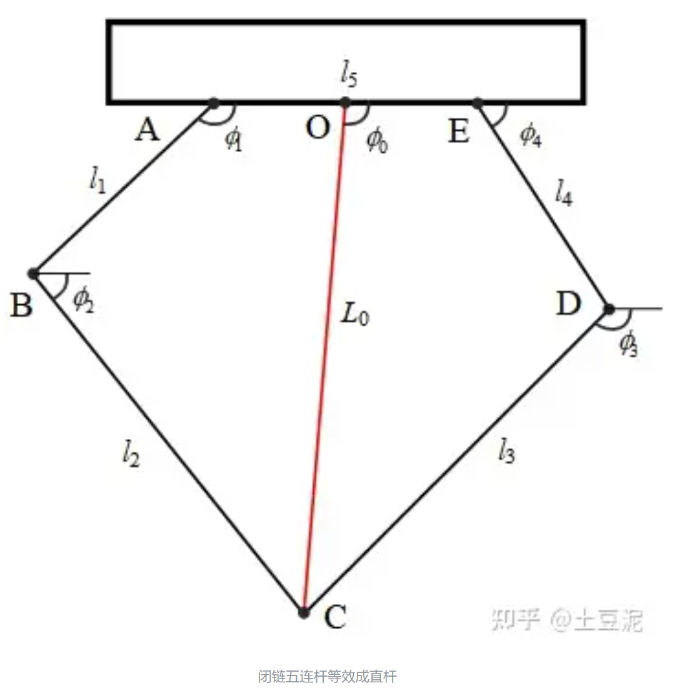

为什么要以及为什么能做这样的简化呢？

1.从运动学角度来看，当我们确定φ1，φ4，就能确定唯一的φ0，L0，这被成为运动学正解；反之，确定了φ0，L0，也能确定唯一的φ1，φ4，这被成为运动学逆解。

2.从动力学角度来看，A,E处两个电机产生的扭矩通过五连杆机构的传递，对于机体和轮子的作用，能够等效通过沿OC杆的推力和绕O,C点的扭矩来表示。

综上，如果能设计一个既能绕点O摆动，又能沿杆的方向伸缩的机构，与这种并联腿是等效的。因为如图简化模型能避免因为五连杆机构运动的复杂性所带来的繁杂运算。

然而对于平衡问题来说，L0主要影响的是腿长；但φ0的变化会很大程度上影响到俯仰角的控制，因此我们这里采用轮足倒立摆模型去实现控制

首先我们需要明白在倒立摆模型中当车身向右倾倒的时候，该如何去保持平衡

设当竖直静止时质心O到轮轴C的距离为L0，车身向右倾斜角度为θ，此时质心与轮轴的高度差为h，且水平偏移量为d则有：

h=L0cosθ     （1.1.3-1）

d=L0sinθ     （1.1.3-2）

此时重力产生一个顺时针倾覆力矩：

$$
\tau_{O}=mg\cdot L0\sin \theta (1.1.3-3)
$$

为了让车保持平衡，轮子需要拥有一个加速度，从而产生一个恢复力矩来抵消掉倾覆力矩的作用，则有：

$$
\tau_{C}=ma\cdot L0\cos \theta (1.1.3-4)
$$

$$
\tau_{O}=\tau_{C}(1.1.3-5)
$$

综上，当车身向右倾倒时。轮子需要产生向右的加速度来使得车身恢复平衡。

**因此我们可以得出整车设计时需要考虑的第一个点：尽量保证车身质心在两髋关节电机中心所形成的垂直平分线上**

## 1.1.4理论分析

这里我们参考的论文是腾讯的2021年的ICRA文章就是基于平衡车动力学模型做的控制。

S. Wanget al., "Balance Control of a Novel Wheel-legged Robot: Design and Experiments, " 2021 IEEE International Conference on Robotics and Automation (ICRA), Xi'an, China, 2021, pp. 6782-6788,

在论文中，忽略了腿的质量，把机体质量M集中在直杆顶部，并考虑底部轮子的质量m，则非线性动力学模型为：

$$
\left\{ \begin{aligned}(M+N)\ddot{x}+ml\cos (\theta )\ddot{\theta}-ml\sin (\theta ){\dot{\theta}}^{2}=u (1.14-1.1) \\ ml\cos (\theta )\ddot{x}+ml^{2}\ddot{\theta}-mgl\sin (\theta )=0 (1.14-1.2)\end{aligned}(1.1.4-1) \right.
$$

其中(1.1)为系统在水平方向的驱动力u（即电机所施加在水平方向的力）

（1.2）则表示力矩平衡方程，即惯性力矩，倾覆力矩，以及牵连惯性力的合力矩在任意时刻合力矩均为0

假设θ是偏离垂直方向上的一个小角度，则有

$$
\cos \theta \approx 1\text{，}\sin \theta \approx \theta \text{，}{\dot{\theta}}^{2}\approx 0 (1.1.4-2)
$$

将式（2）代入到（1）中可以得到线性化的系统状态方程

$$
\dot{\xi}=A\xi +Bu
$$

其中 $\xi$ 为状态向量，其中包含了角度θ、角速度 $\dot{\theta}$（ω）、位置x、速度 $\dot{x}$（v）

矩阵A为系统矩阵，描述了物体本身所具有的物理特性

矩阵B为输入矩阵，它描述了外力（即电机推力u）对物体状态的影响能力

计算思路：利用（2）的近似化处理简化式（1），通过移项消元来求解出目标函数，这里不列出具体的计算过程。

(1.1.4-3)

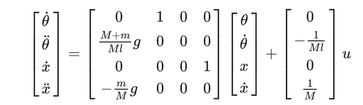

接着我们可以得出该状态方程所涵盖的物理意义

### 含义1

$$
\ddot{\theta}=A_{21}\theta +B_{21}u
$$

$\ddot{\theta}=\frac{M+m}{Ml}g\cdot \dot{\theta}+(-\frac{1}{Ml})\cdot u (1.1.4-4)$

首先我们先设θ向右增长为正方向，则我们可以得知当 $\dot{\theta}$ 增大时， $\ddot{\theta}$ 也会随之增大，倾覆力矩也会随之增大。通过前面系数 $A_{21}=\frac{M+m}{Ml}g$ 我们可以得知：当腿长不变时，车身占整车质量越小，即 $\frac{M+m}{M}$ 越大时重力产生的倾覆力矩相对于转动惯量的影响越显著，系统越不稳定，此时车越容易失控；当 $\frac{M+m}{M}$ 时，l越长，由于转动惯量是根据 $l^{2}$ 进行指数增长，即使此时重力力臂变长，倾覆力矩增大，此时车倾倒所需时间变长，更利于控制。

**综上所述，我们可以得到第二个设计时需要考虑的要点：车身占整车的质量比与腿长会影响到整车的控制难度与稳定性**

### 含义2

而根据 $B_{21}=-\frac{1}{Ml}$ 我们可以得知，当l不变时M越小，此时u的作用效果越明显；M不变时，l越小，此时u的作用效果越明显

**综上，我们可以得到第三个设计要点：我们应尽量减小车身质量，减小腿长，来保证电机处于运动中最高级的影响因素，降低控制难度。**

但我们发现第二第三点设计要点存在冲突，因此如何权衡腿长是后续设计计算时需要权衡的地方。

### 含义3

接着我们看另外一个状态方程所具有的物理含义

$$
\ddot{x}=A_{41}\theta +B_{41}u
$$

$$
\ddot{x}=-\frac{m}{M}g\dot{x}+\frac{1}{M}u (1.1.4-5)
$$

通过 $A_{41}=-\frac{m}{M}g$ 我们可以得知：当 $\frac{m}{M}g$ 越大时，加速度越小，整车的响应速度越慢，稳定性越低

**因此，我们可以得到第四个设计要点：应尽量减小足部质量相对于车身质量的比值，考虑到足部质量较小，则我们应该倾向于增大车身质量**

### 含义4

通过 $B_{41}=\frac{1}{M}$ 我们可以得知：当车身质量越小时，电机推力在系统中的权重更大。

**因此，我们可以得到第五个设计要点：应增大车身质量，来保证系统的稳定性**

我们依然会发现第四第五点的设计要点也会发生冲突，因此在设计时也要注意权衡车身质量大小

传统并腿的设计

## 1.2关节电机的选型

## 1.2.1扭矩的计算公式

虚功原理：所有主动力再任意一组虚位移上所做的虚功之和为0

设虚位移为（δr，δθ）

这里有两组广义坐标

关节空间：电机转角θ，对应驱动力矩 τ

笛卡尔空间：末端位姿x= ${[\text{x，y，Φ，...}]}^{T}$，对应外力/力矩F= ${[f_{x}\text{，}f_{y}\text{，}m_{z}]}^{T}$

根据虚功原理，系统平衡时有δW= $\tau^{T}$δθ— $F^{T}$δx=0

即 $\tau^{T}$δθ= $F^{T}$δx （1）

引入雅可比矩阵

δx=J*δθ （2）

将（2）代入到（1）中，化简得

$\tau^{T}-F^{T}$ J=0

即 $\tau^{T}$= $F^{T}$ J

进行矩阵的转置

得  τ=F $J^{T}$

最终我们得到电机扭矩的关系式

${\tau =J}^{T}\cdot \gamma$ 其中，τ=[ $\tau_{1}\tau_{2}$]，γ= ${[F_{x}F_{y}]}^{T}$  (1.2.1-1)

## 1.2.2计算步骤

基于式1.1.1-1，我们可以构建以下步骤完成

步骤1 通过腿部结构的物理模型计算末端执行器的坐标（x，y）

步骤2 将两个关节电机角分别对末端执行器的坐标（x，y）求偏导，得到雅可比矩阵J

步骤3 根据实际物理模型进行受力分析，得到机器人的腿部水平方向受力 $F_{x}$ 和竖直方向受力 $F_{y}$

步骤4 根据步骤2和步骤3得到的雅可比矩阵和支持力代入式1.1.1-1中计算得到关节电机扭矩表达式

步骤5 代入计算具体参数既可算出确定的扭矩的大小

## 1.2.3计算过程

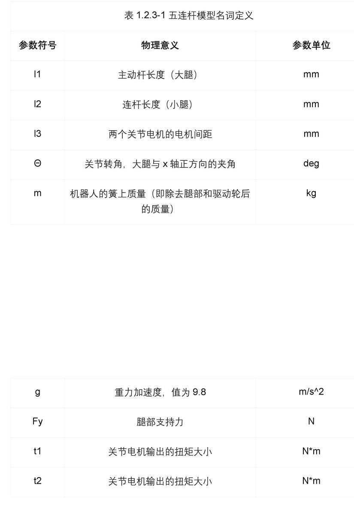

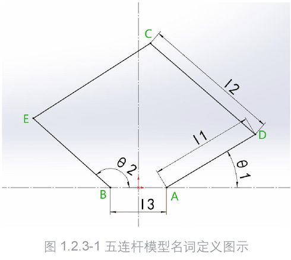

步骤1

$D_{x}$= $l_{1}$*cos（ $\theta_{1})$+ $\frac{l_{3}}{2}$ （1.2.3-1）    $D_{x}$= $l_{1}$*sin( $\theta_{1}$) （1.2.3-2）

$E_{x}$= $l_{1}$*cos（ $\theta_{2})$+ $\frac{l_{3}}{2}$ （1.2.3-3）    $E_{x}$= $l_{1}$*sin( $\theta_{2}$) （1.2.3-4）

基于matlab的函数，通过画圆法，得到末端执行器C的坐标公式

步骤2

将 $\theta_{1}$ 和 $\theta_{2}$ 分别对 $C_{x}$ 和 $C_{y}$ 求偏导，得到雅可比矩阵J

### 步骤3

当机器处于静力平衡时，受力分析得，机体单腿的竖直方向上的力为机体簧上质量的一半，水平方向不受力

即 $F_{y}=$ mg/2 （1.2.3-5）     $F_{x}$=0 （1.2.3-6）

### 步骤4

将上述的扭矩公式,我们可以算出关节电机的扭矩大小

${[\tau_{1}\tau_{2}]}^{T}$= $J^{T}\cdot {[F_{x}F_{y}]}^{T}$

步骤5

将具体的l1，l2，θ1，θ2数值代入计算，即可以求得当前状态下的关节电机扭矩

## 1.2.4串腿（偏置并联）的扭矩计算

名词定义如表所示

KK

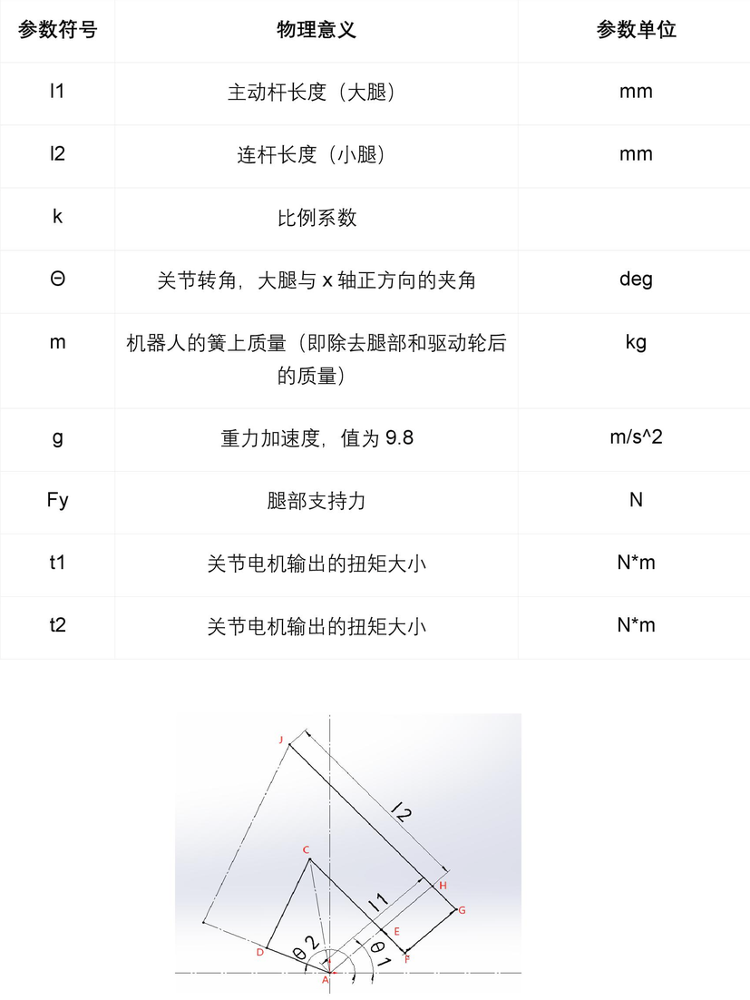

从图中可以看到，偏置并联和并联并联杆的区别在于，偏置并联的共轴设计使得两个电机间的距离l3=0，同时增加了比例系数k。

为了让末端执行器（足部）能够在机器人的正下方，我们通过平行四边形连杆将JH和CE的长度进行等比例约束，使得A,C,J三点共线。

由于驱动AD杆电机所形成的运动连为：A-D-C-E-F-G-H-J，其中E-F-G-H为平行四边形结构，有几何关系如下：

$\frac{AD}{AH}$= $\frac{CE}{HJ}$=k （1.2.4-1）     CD=CE （1.2.4-2）

AH=l1 （1.2.4-3）     HJ=l2（1.2.4-4）

AD=AE=k*l1 （1.2.4-5）    CD=CE=k*l2 （1.2.4-6）

即将AH与FG的作用等效

CF与JG的作用等效

让复杂的偏置并联结构变成五连杆结构

（其中机架l3被省略，ADCE,AKJH均可被视作五连杆去计算）

### 步骤1

基于坐标系和几何关系，我们可以求得E点，D点和H点的坐标

$D_{x}$=k*l1*cos（θ1） （1.2.4-7）     $D_{y}$=k*l1*sin（θ1） （1.2.4-8）

$E_{x}=k\cdot l1\cdot \cos (\theta 2)$ （1.2.4-9）    $E_{y}=k\cdot l1\cdot \sin (\theta 2) (1.2.4-10)$

$H_{x}=l1\cdot \cos (\theta 1) (1.2.4-11)$       $H_{y}=l1\cdot \sin (\theta 1) (1.2.4-12)$

基于matlab的函数，通过画圆法，我们可以得到点C的坐标公式

由于CE和HJ存在比例关系，因此可以根据向量法求得末端执行器点J的坐标

$$
\vec{AJ}=\vec{AH}+\vec{HJ}=\vec{AH}+\frac{1}{K}\vec{EC}
$$

$$
\vec{EC}=\vec{AC}-\vec{AE}
$$

$$
\vec{AJ}=\vec{AH}+\frac{1}{K}(\vec{AC}-\vec{AE}) (1.2.4-13)
$$

则由（1.2.4-13）可得

$J_{x}=\text{（}H_{x}+\frac{1}{K}(C_{x}-E_{x})) ($ 1.2.4-14）

$$
J_{y}=\text{（}H_{x}+\frac{1}{K}(C_{y}-E_{y})) (1.2.4-15)
$$

### 步骤2

基于步骤1的结果，将θ1和θ2分别对 $J_{x}$ 和 $J_{y}$ 求偏导，得到雅可比矩阵J

### 步骤3

在机体处于精力平衡时，受力分析得，机体单腿的竖直方向上的力为机体簧上质量的一半，水平方向不受力

即 $F_{y}=$ mg/2 （1.2.4-16）     $F_{x}$=0 （1.2.4-17）

### 步骤四

将上述的扭矩公式,

即 ${[\tau_{1}\tau_{2}]}^{T}$= $J^{T}\cdot {[F_{x}F_{y}]}^{T}$

步骤五

将具体的l1，l2，l3，θ1，θ2数值代入计算，即可以求得当前状态下的关节电机扭矩

## 1.2.5并联五连杆和偏置并联的关节电机扭矩比较

通过输出结果，我们可以得到一个结论：偏置并联构型和并联五连杆构型再输入量一致时，两种构型的关节电机的扭矩相同，并不会因为偏置并联构型复杂的连杆结构影响关节扭矩

## 1.2.6偏置并联构型的k值

在1.1.5比较两种构型的电机的扭矩时，我们没有考虑到k值的影响，接下来通过固定变量法，讨论k值对扭矩的影响

固定l1，l2，θ1，θ2的值

通过计算可得当k=0.2，k=0.5，k=0.8时

电机输出的扭矩大小并不会受到影响

接下来我们讨论k值大小所影响的地方

根据理论力学的知识，做出偏置并联的受力分析图

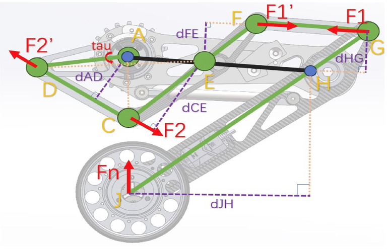

CD，FG均为二力杆，其受力均连杆端点连线的方向，因此可以得到F1,F1’,F2,F2’的方向，此时J点受到地面对其竖直方向上的支持力FN。

对连杆JHG分析，对H点进行合力矩计算

$$
\sum_{}^{} M_{H}=-F_{n}\cdot d_{JH}+F_{1}\cdot d_{HG}=0 (1.2.6-1)
$$

对连杆CEF分析，对E点进行合力矩计算

$$
\sum_{}^{} M_{E}=F_{2}\cdot d_{CE}+F_{1}'\cdot d_{FE}=0 (1.2.6-2)
$$

因为EFGH为平行四边形，则 $d_{HG}=d_{FE}$  （1.2.6-3）

联立1.2.6的123式可得

$$
F_{1}=\frac{d_{JH}}{d_{HG}}\cdot F_{n}(1.2.6-4)
$$

$$
F_{2}=\frac{d_{JH}}{d_{CE}}\cdot F_{n}(1.2.6-5)
$$

由1.2.6-3式可得：HG与JH的差距越大，F1越大，对F点和G点处轴系的径向冲击载荷越大

由J和H的坐标可得 $d_{JH}=|x_{J}-x_{H}|$

$d_{CE}$ 的大小可以通过三角形面积公式得

在三角形DCE中，有：

$$
S_{\Delta DCE}=\frac{1}{2}DC\cdot d_{CE}(1.2.6-7)
$$

$$
S_{\Delta DCE}=\frac{1}{2}|\vec{ED}\times \vec{EC}| (1.2.6-8)
$$

$$
\vec{ED}=(D_{x}-E_{x}\text{，}D_{y}-E_{y}) (1.2.6-9)
$$

$$
\vec{EC}=(C_{x}-E_{x}\text{，}C_{y}-E_{y}) (1.2.6-10)
$$

$$
DC=\sqrt{(D_{x}-E_{x})^{2}+(D_{y}-E_{y})^{2}}(1.2.6-11)
$$

$d_{CE}$=| $\frac{\vec{ED}\times \vec{EC}}{DC}|=|\frac{(D_{x}-E_{x})\cdot (C_{y}-E_{y})-(D_{y}-E_{y})\cdot (C_{x}-E_{x})}{\sqrt{(D_{x}-E_{x})^{2}+(D_{y}-E_{y})^{2}}}| (1.2.6-12)$

由1.2.6的式（4）（5）（11），通过matlab计算，我们可以得到F2的大小，代入不同的k值可以得到不同的F2

可得： k值的大小影响到外力对连杆铰点的冲击载荷大小，k值越小，对连杆铰点轴系的径向冲击越大

因此我们需要选用冲击载荷更高的轴承以保证轴系的强度和刚度

## 1.2.7对两种构型关节电机扭矩大小的进一步说明

通过上文的计算我们可以得到偏置并联结构与并联五连杆构型在力和扭矩传递上效果一致的结论

但为了进一步验证力在多级连杆的传动下效果与并联五连杆相同，我们可以基于上一步CD连杆受力大小的方式进行验证。DC杆在D点受到的力F2’由AD所在的关节电机扭矩产生，C点受到的力F2通过一系列连杆进行传递，根据牛三率，则应该有F2’=F2

因此我们可以分别计算出F2’和F2，如何两者相同，既可以认为多级连杆的传动不影响力的传递

对AD杆分析，对A点进行合力矩计算

$$
\sum_{}^{} M_{A}=F2'\cdot d_{AD}-\tau =0 (1.2.7-1)
$$

在三角形ADC中，有：

$$
S_{\Delta ADC}=\frac{1}{2}DC\cdot d_{AD}(1.2.7-2)
$$

$$
S_{\Delta ADC}=\frac{1}{2}|\vec{AD}\times \vec{AC}| (1.2.7-3)
$$

$$
\vec{AD}=(D_{x}\text{，}D_{y}) (1.2.7-4)
$$

$$
\vec{AC}=(C_{x}\text{，}C_{y}) (1.2.7-5)
$$

$$
d_{AD}=|\frac{D_{x}\cdot C_{y}-D_{y}\cdot C_{x}}{\sqrt{(D_{x}-E_{x})^{2}+(D_{y}-E_{y})^{2}}}| (1.2.7-6)
$$

通过matlab代码，我们可以算出F2与F2’的大小

通过计算结果，我们发现，关节角和k值在任意数值下，F2与F2’的数值时刻都能保持相等，因此结论成立：在理想条件下，偏置并联构型和并联五连杆构型在输出量一致时，两种构型的关节电机的扭矩相同，并不会因为偏置并联构型复杂的连杆结构影响关节扭矩。

## 2.1连杆参数设计

通过上文的论述，我们可以得到以下几个结论：

结论1：串联腿和并联腿得到控制方法基本相同，只需要更改实际模型与虚拟模型的映射关系即可

结论2：两种构型的关节电机负载情况基本相同，并不会因为偏置并联杆的结构复杂而影响

结论3：偏置并联构型的k值不影响关节电机的负载

结论4：偏置并联构型的k值影响连杆绞点处的负载，k值越小，对连按绞点处轴系的径向冲击载荷越大。

根据结论2，3我们可以认为并联五连杆和偏置并联构型的连杆参数设计体系是一样的。

因为偏置并联构型的连杆结构复杂且连杆数量多，因此在对偏置并联构型进行参数设计时，将基于并联五连杆的模型进行体系搭建

## 2.2.1比赛规则需求分析

根据RoboMaster机甲大师超级对抗赛机器人制作规范手册中，影响轮腿连杆参数（腿长）的有以下几点要求：

要求1：步兵机器人制作参数，要求其高度的最大初始尺寸小于500mm，最大伸展尺寸小于800mm。

要求2：地面机器人任意两块装甲模块下边缘高度差不超过100mm。

要求3：对于地面机器人，变形前后，装甲模块下边缘距离地面高度必须在

60mm~400mm范围内。

要求4：为了提高轮腿机器人的地形跨越能力，我们要求轮腿机器人至少有200的形变程度、300mm以上（350mm以上更佳）的跳跃能力

云台的设计的高度在300mm（算入丝杆），因此可以得到要求5

要求5：关节电机连线几何中心离地面的最高高度不超过500mm（800mm-300m

），离地面的最低高度不超过200（500mm-300mm）

我们需要在以上提到的要求下进行连杆参数设计，根据5个要求，我们对轮腿机器人机械性能的评估有如下几个指标：

指标1 轮腿机器人z轴方向上的形变程度要足够大（地形跨越能力）

指标2 轮腿机器人z轴方向上的形变速度要快（动态性能能力）

指标3 轮腿机器人要跳的高（地形跨越能力）

指标4 轮腿机器人的负载尽可能低（赛场稳定性）

## 2.1.2并联腿连杆参数

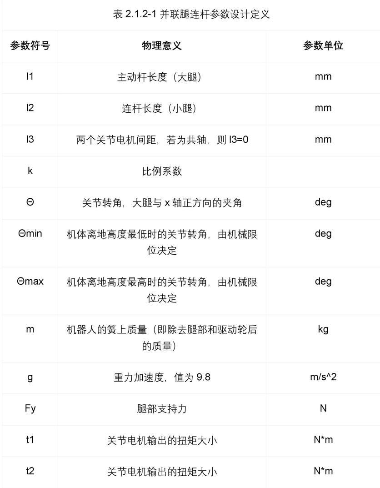

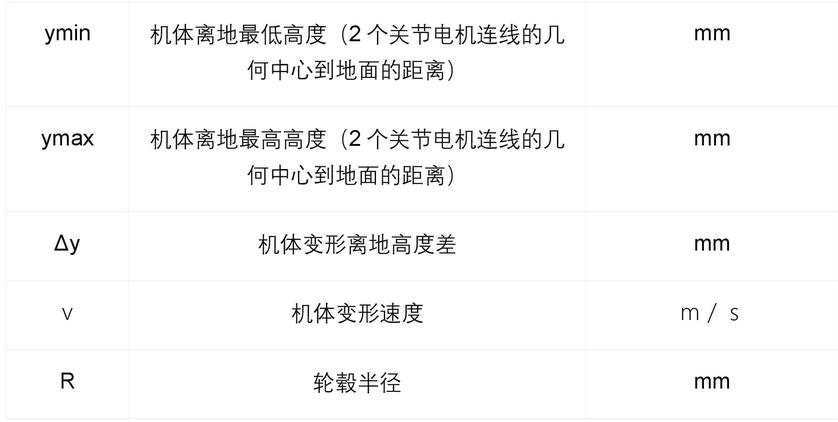

## 2.1.3并联腿连杆参数设计思路

由于不同的l1l2长度组合会产生不同形变高度差、形变速度、以及关节电机扭矩，因此我们基于并联腿连杆几何模型找到形变高度差Δy、形变速度V、以及关节电机平均输出扭矩τ的表达式，再通过枚举的方式的到不同l1、l2组合下相关的性能指标，对性能指标设置不同的权重系数来求出相应的连杆参数。

## 2.1.4形变高度Δy、形变速度v

由于指标123都是对轮腿机器人z轴方向上的性能进行评估，因此为了简化计算，我们让两个关节电机输出的角度绝对值相等，即2个小腿和2个大腿对称分布，末端执行器始终位于两个关节电机连线几何中心所在的竖直线上，因此，我们只需要对其中一边大腿和小腿进行计算，就可以得到形变高度差Δy和形变速度v的表达式。

参考1.1.3的建模方法我们得出如图所示的建模：

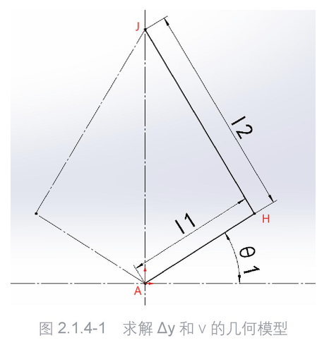

根据几何关系，我们可以求出点J的y坐标，加上驱动轮的半径即可得到关节电机连线几何中心到地面的行程h

通过将机体离地高度最低时的关节转角 $\theta_{\min}$ 和离地高度最高时的转角 $\theta_{\max}$ 代入做差，我们可以得到机体离地高度的最低高度 $y_{\min}$ 和机体离地高度最高高度 $y_{\max}$ 以及形变高度差Δy

由于h是关于角度的公式h=f（θ），通过描点法，我们可以得到h的图像

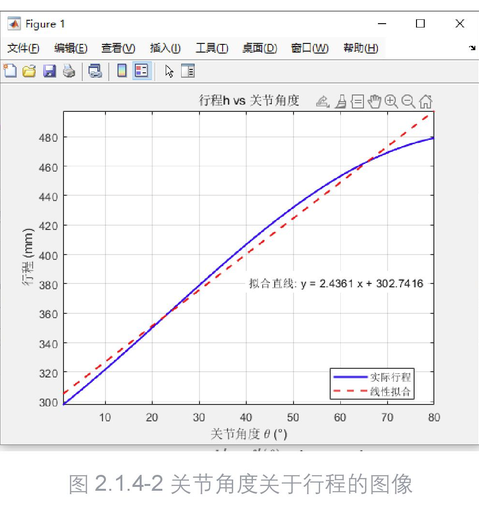

显然，行程h并不线性，但可以近似看成一条直线，因此，我们可以对图像进行一阶线性拟合得到平均速度，用来评估该连杆参数下的形变速度V

## 2.1.5关节电机平均输出扭矩τ

根据1.1.3思路，我们可以得到τ的计算方法，由于雅可比矩阵J是一个关于关节电机角度 $\theta_{1}$、 $\theta_{2}$ 的矩阵，因此不同的关节角度会对关节电机造成不同扭矩，为了让机器人能在安全工况下行驶，我们需要找到连杆参数下不同关节角度组合的最大输出扭矩、最小输出扭矩以及机器人从离地高度的最低高度 $y_{\min}$ 运动到离地高度的最高高度 $y_{\max}$ 时的2平均输出扭矩。让这三个值都处于电机得额定扭矩值之下，就能保证机器人在赛场上的稳定性。

## 2.1.6连杆数据获取

通过前面两端论述，我们得到了有关形变高度差Δy、形变速度v、关节电机平均输出扭矩τ，最大输出扭矩 $\tau_{\max}$ 和最小输出扭矩 $\tau_{\min}$ 有关l1、l2的表达式，我们就可以通过枚举的方法得到不同组合下相关的性能指标。

## 2.2并联腿跳跃高度计算

## 2.2.1计算思路

将整个跳跃过程分为3个阶段

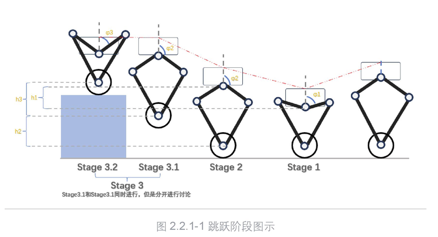

Stage1：轮腿机器人收腿，此时机体高度离地面最低，关节角度为Φ1

Stage2：轮腿机器人伸腿，直到轮子离地前的最后一刻，此时关节角度为Φ2，机体高度位移量为h1

Stage3：轮腿机器人跳跃到最高处，该阶段分为stage3.1和stage3.2两个部分同时进行，但分开讨论：

Stage3.1：轮腿机器人保持关节角Φ2进行斜抛运动，水平方向的速度由驱动轮提供，跳跃高度为h2

Stage3.2：轮腿机器人收腿，此时关节角为Φ3，收腿高度为h3

因此，机器人跳跃的整体高度为H=h2+h3

高度计算步骤如下：

步骤1：先设定理论条件，在该理论条件下进行并联腿机器人简化模型的静力学分析得到机器人在平衡时两个关节电机的关系式

步骤2：将机器人跳跃高度分解为斜抛运动高度h2和主动缩腿高度h3两部分，结合步骤1获得的角度关系式对机器人进行动力学分析，采用机械守恒定律和动量定理，从而得到目标函数

步骤3：基于机器人实际机械结构的约束条件和空中姿态的约束条件，构建各个变量的约束条件：根据机器人的实际参数数据，利用粒子群（PSO）优化算法在约束条件范围内对目标函数进行寻优求解，从而得出并联腿机器人的跳跃最优参数

## 2.2.2步骤1

### 步骤1.1

设定理论条件，理论条件包括以下5个假设：

躯体质心在两个关节电机连线中心竖线上，且躯体保持水平

轮子与地面为滚动摩擦，无打滑，且两者接触无变形

所有关节之间没有摩擦或碰撞，均为转动关节

机器人所有部分都是刚体

忽略电机动力学，即忽略电机内部的转动情况

### 步骤1.2

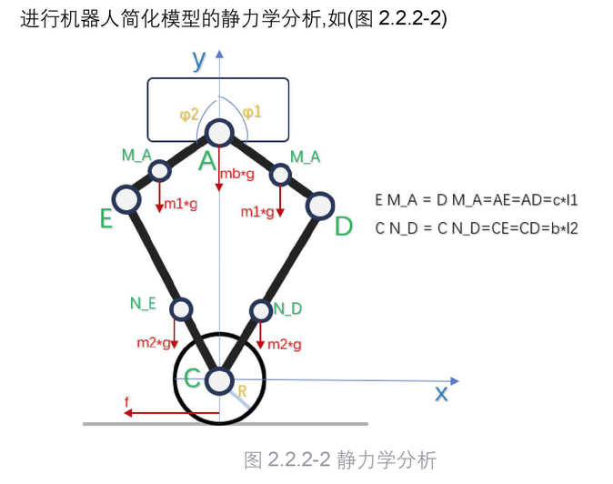

以水平地面为x轴、以垂直于地面的方向为y轴建立坐标系。根据质心运动定理，求解质心坐标，在x轴有：

$$
X_{C}=\frac{\sum_{}^{} m_{i}x_{i}}{\sum_{}^{} m_{i}}=\frac{1}{\sum_{}^{} m_{i}}(m_{1}g\sin (\phi 1)+m_{2}g\sin (\angle ACD-m_{1}g\sin (\phi 1)-m_{2}g\sin \angle ACE+m_{b}g(\sin \phi 1-\sin \phi 2))=0 (2.2.2-1)
$$

其中， $m_{2}$ 是小腿质量， $m_{1}$ 是大腿质量， $m_{b}$ 是躯体质量，l2，l1分别是小腿和大腿的长度，φ1、φ2分别是两个关节电机的输出角度（定义角度为连杆与y轴正方向的夹角）

从而得到机器人在地面运动运动处于平衡时，两个关节电机角度的表达式

$$
\phi_{1}=\phi_{2}(2.2.2-2)
$$

因此，在整个阶段中，两个关节角度电机时刻相等，因此后续计算只需要考虑φ1的大小

### 步骤1.3

在后续的计算中需要3个阶段各点的坐标，由于关节角度的标注因素，无法直接求得各个点的关节坐标，因此坐标计算公式将参考1.2.3的坐标计算方法进行计算。

通过齐次变换矩阵完成从以A点为原点的坐标系到以O点为原点的坐标系转换

$$
[\begin{matrix}X^{C} \\ Y^{C}\end{matrix}]=R_{A[3\times 3]}^{C}\cdot [\begin{matrix}X^{A} \\ Y^{A}\end{matrix}] (2.2.2-3)
$$

通过几何关系可以得到：

$$
R_{A[3\times 3]}^{C}=[\begin{bmatrix}1 & 0 & {-C}_x^{4} \\ 0 & 1 & {-C}_y^{A} \\ 0 & 0 & 1\end{bmatrix}] (2.2.2-4)
$$

结合1.1.3的坐标计算方法，式2.2.2-2和式2.2.2-4，我们可以得到以下坐标公式：

A点坐标（A $x_{\phi i}\text{，}Ay_{\phi i}$）；D点坐标（D $x_{\phi i}$，D $y_{\phi i}$）；E点坐标（E $x_{\phi i}$,E $y_{\phi i}$）;

AD杆质心 $M_{D}$ 点坐标（ $M_{Dx\phi i}\text{，}M_{Dy\phi i}$）;AE杆质心 $M_{E}$ 点坐标（ $M_{Ex\phi i}\text{，}M_{Ey\phi i}$）;

DC杆质心 $N_{D}$ 点坐标（ $N_{Dx\phi i}\text{，}N_{Dy\phi i}$）;EC杆质心 $M_{E}$ 点坐标（ $N_{Ex\phi i}\text{，}N_{Ey\phi i}$）;

其中i=1，2，3，表示不同阶段时的关节角度，均可以matlab代码实现

## 2.2.3步骤2

通过对stage1到stage2进行分析，的大躯体速度Vb关于l1，l2，φ1，φ2，τ的表达式。

### 步骤2.1：

对stage1到stage2，有：驱动轮一直与地面接触，关节角度由φ1变成φ2，机体在竖直方向的位移为h1.

在stage2的时刻，对机器人进行瞬时速度分析，此时假设躯体无转动并平行于地面，设轮子速度为 $V_{w}$、大腿AD杆的速度 $V_{AD}$，大腿AE杆速度 $V_{AE}$、小腿EC杆的速度 $V_{EC}$、小腿DC杆的速度 $V_{DC}$、和躯体速度 $V_{b}$，轮子质量 $m_{w}$、小腿质量 $m_{2}$，大腿质量 $m_{1}$，和躯体质量 $m_{b}$

对stage1到stage2阶段进行机械能守恒分析，该阶段关节电机以恒定扭矩τ做功W，有：

$$
W=\int_{\phi 1}^{\phi 2} \tau d\phi =\tau (\phi 2-\phi 1) (2.2.3-1)
$$

应用机械能守恒定律得到

W=（ $m_{1}$ g $h_{AD}$+ $m_{1}$ g $h_{AE}$+ $m_{2}$ g $h_{DC}$+ $m_{2}$ g $h_{EC}$+ $m_{b}$ g $h_{1}$+（ $\frac{1}{2}m_{1}v_{AD}^{2}$+ $\frac{1}{2}m_{1}v_{AE}^{2}$+ $\frac{1}{2}m_{2}v_{DC}^{2}$+ $\frac{1}{2}m_{2}v_{EC}^{2}$+ $\frac{1}{2}m_{b}v_b^{2}$）    （2.2.3-2）

其中， $h_{AD}$、 $h_{AE}$、 $h_{DC}$、 $h_{EC}$ 分别为AD、AE、DC、EC杆质心的位移量，分别为：

$h_{AD}=M_{Dy\phi 2}-M_{Dy\phi 1}(2.2.3-3)$;     $h_{AE}=M_{Ey\phi 2}-M_{Ey\phi 1}(2.2.3-4)$;

$h_{EC}=M_{Ey\phi 2}-M_{Ey\phi 1}(2.2.3-5)$;     $h_{DC}=N_{Ey\phi 2}-N_{Ey\phi 1}(2.2.3-6)$;

$h_{1}$ 为A点的位移量， $h_{1}=Ay_{\phi 2}-Ay_{\phi 1}(2.2.3-7)$

步骤2.2：

根据速度瞬心法求得 $V_{AD}$、 $V_{AE}$、 $V_{EC}$、 $V_{DC}$ 关于 $V_{b}$ 的关系式。

对轮腿腿部作出速度瞬心图

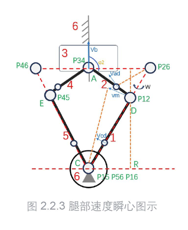

由于在stage1到stage2，驱动轮不离开地面，因此认为点C固定；

根据五连杆的几何关系和两关节电机的输出角度绝对值相等，认为机体沿着竖直的“滑轨”移动；

速度瞬心图定义如下：

CD杆为构件1；AD杆为构件2；AE杆为构件4；EC杆为构件5；

机体为构件3；固定支座（即下方轮处）和滑轨为构件6

瞬心做图过程（理论基础为《机械原理》）：

1.根据构件间的直接联系关系，我们可以得到瞬心P12、P34、P45、P15、P56

构件3为滑块，沿着构件6滑轨在垂直方向运动，所有其瞬心在垂直于导轨方向（水平方向）的无穷远处

2.利用三心定理（三个彼此作平面运动的构件的三个瞬心必在同一条直线上）得出P46、P26的位置

2.1计算P46

取构件3，4，6：P34在A点上，P36在垂直于导轨6的水平直线上的无限远处，则P46在过点A的水平直线上

取构件4，5，6：P45在点E上，P56在点C上，则P46在直线EC上

综上：P46是过点A的水平线于EC的延长线的交点。

P26同理

2.2计算P16

取构件1，2，6：P12在点D上，则P16在P26和P12连线所形成的直线D-P26上

取构件1，5，6：P15、P56均在点C上

综上：P16在点C上

根据图解法可以得到需要用到的速度瞬心的位置，进而求出 $V_{AD}$、 $V_{AE}$、 $V_{EC}\text{和}V_{DC}$ 的大小

由于P46和P26是相对于静系的瞬心，因此为绝对瞬心，其ω保持不变

因此假设AD杆的角速度ω，有

$$
V_{b}=\omega \times {AP}_{26}(2.2.3-8);V_{m}=\frac{{DP}_{26}}{{AP}_{26}}V_{b}(2.2.3-9);
$$

$$
V_{CD}=c\cdot V_{m}(2.2.3-10);V_{AD}=\frac{M_{D}P_{26}}{{AP}_{26}}V_{b}(2.2.3-11)\text{；}
$$

$$
V_{b}=\omega \times {AP}_{46}(2.2.3-12);V_{E}=\frac{{EP}_{46}}{{AP}_{46}}V_{b}(2.2.3-13) ;
$$

$$
V_{CE}=c\cdot V_{E}(2.2.3-14);V_{AE}=\frac{M_{E}P_{46}}{{AP}_{46}}V_{b}(2.2.3-15);
$$

其中， ${AP}_{26}\text{、}{DP}_{26}\text{、}{AP}_{46}\text{、}{EP}_{46}\text{、}M_{D}P_{26}\text{、}M_{E}P_{46}$ 可以通过对坐标求两点间距离公式得到。

$V_{m}$ 即为在杆AD中点D的速度，而因为D点也在杆CD上，因此AD于CD在点D的速度均相等，因此可以借助 $V_{m}$ 来间接求出 $V_{CD}$（式10），式14同理

$M_{D}$、 $M_{E}$ 分别为杆AD和AE的质心，通过质心速度来得出杆的速度

结合2.2.3的式（1）——（15），可以得到 $V_{b}$ 的表达式

$$
V_{b}=f_{1}(l1\text{，}l2\text{，}\phi 1\text{，}\phi 2\text{，}\tau ) (2.2.3-16);
$$

### 步骤2.3：

通过对stage2到stage3.1进行分析，得到躯体速度 $V_{b}$ 关于 $l1\text{，}l2\text{，}\phi 1\text{，}\phi 2\text{，}\tau$ 的表达式，进一步得到h2的表达式

在该阶段中，机器人各部件相对静止，整体做斜抛运动，水平方向的速度由驱动轮提供，竖直方向的速度由stage1到stage2时，关节电机输出的扭矩提供。

在竖直方向上，设机器人质心处的竖直方向速度 $V_{y}$，整体质量为 $m_{z}$，对stage2到stage3.1，利用机械守恒定理可得：

$$
\frac{1}{2}m_{z}V_y^{2}=m_{z}gh_{2}(2.2.3-17);
$$

$$
V_{y}=\sqrt{2gh_{2}}(2.2.3-18);
$$

根据动量的定义，质点系的动量等于质心速度于其全部质量的乘积，则有

其中， $V_{y}$ 是质心的竖直速度， $V_{iy}$ 是机器人六个部分所需的竖直速度，由几何关系得：

$$
m_{z}V_{y}=V_{AE}m_{1}+V_{AD}m_{1}+V_{DC}m_{2}+V_{EC}m_{2}+V_{by}m_{y}+V_{wy}m_{w}(2.2.3-19);
$$

$$
V_{by}=V_{b}(2.2.3-19);
$$

$$
V_{wm}=0 (2.2.3-20);
$$

$$
V_{CDy}=V_{CD}\cdot \sin \angle CDR=V_{CD}\cdot \frac{D_{x}\phi_{2}}{l_{2}}(2.2.3-21)\text{；}
$$

$$
V_{ADy}=V_{AD}\cdot \cos \angle M_{D}P_{26}A=V_{AD}\cdot \frac{{AP}_{26}^{2}+D_{M}P_{26}^{2}-{AD}_M^{2}}{{AP}_{26}\cdot D_{M}P_{26}}(2.2.3-22);
$$

同理可得另外两个构件AE和EC得竖直速度

$$
V_{CEy}=V_{CE}\cdot \frac{E_{x}\phi_{2}}{l_{2}}(2.2.3-23)\text{；}
$$

$$
V_{AEy}=V_{AE}\cdot \frac{{AP}_{46}^{2}+E_{M}P_{46}^{2}-{AE}_M^{2}}{{AP}_{46}\cdot E_{M}P_{46}}(2.2.3-24);
$$

其中， ${AP}_{26}\text{、}D_{M}P_{26}\text{、}{AP}_{46}\text{、}E_{M}P_{46}\text{、}AD_{M}\text{、}AE_{M}$ 可以通过对坐标求两点间距离公式得到。

结合2.2.3的式（17）——（24），可以得到 $V_{b}$ 的表达式

$$
V_{b}=f_{2}(l1\text{，}l2\text{，}\phi 1\text{，}\phi 2\text{，}\tau \text{，}h2) (2.2.3-25);
$$

联立式（2.2.3-16）和（2.2.3-25），可以得到：

$$
h_{2}=f_{3}(l1\text{，}l2\text{，}\phi 1\text{，}\phi 2\text{，}\tau ) (2.2.3-26);
$$

### 步骤2.4：

通过对stage3.1到stage3.2进行分析，得到

这一过程中关节电机角度从φ2变为φ3，机体高度不变，关节电机输出的角度用来让机器人完成收腿的动作，此时收腿高度为h3，h3是一个关于l1，l2，φ1，φ2，φ3，τ的表达式

$$
h_{3}=Ay_{\phi 2}-Ay_{\phi 3}(2.2.3-27);
$$

结合式（2.2.3-26）和（2.2.3-27），我们可以得到H的关于l1，l2，φ1，φ2，φ3，τ的表达式：

$$
H=h_{2}+h_{3}=f_{3}(l1\text{，}l2\text{，}\phi 1\text{，}\phi 2\text{，}\tau ) +Ay_{\phi 2}-Ay_{\phi 3}(2.2.3-28);
$$

H（l1，l2，φ1，φ2，φ3，τ）即为目标函数

## 2.2.4步骤3

在得到目标函数后，还需要我们对变量进行约束，对轮腿机器人跳跃姿态的力学分析和约束方法如下：

### 步骤3.1

在stage1到stage2的过程中，关节电机通过输出扭矩完成机体在竖直方向上的位移为h1。我们假设一作用在机体上的平均作用力 $F_{avg}$，其方向为竖直向上，将其等效代替关节电机所产生的扭矩，结合式（2.2.3-1），由功能关系得：

$$
F_{avg}=\frac{w}{h1}=\frac{\tau (\phi 2-\phi 1)}{h1}(2.2.4-1);
$$

同时为了保证机器人的两轮部分于地面有足够接触和摩擦力，在地面缩腿阶段，需要约束平均作用力不大于整车减去两轮质量的重力

$$
{0<F}_{avg}<(m_{z}-m_{w})g (2.2.4-2);
$$

机器人在运动时，关节电机的最高转速不能超过额定转速，在stage1到stage2的过程中，设整车的平均加速度a1和时间t1，有：

$$
a1=\frac{F_{avg}}{m_{z}}(2.2.4-3);
$$

$$
t1=\frac{m_{z}}{F}\sqrt{2gh1}(2.2.4-4);
$$

进而能得到stage1到stage2的关节电机平均角速度为：

$$
\overline{\omega_{1}}=\frac{\phi 2-\phi 1}{t1}=\frac{(\phi 2-\phi 1)F_{avg}}{m_{z}\sqrt{2gh1}}(2.2.4-5);
$$

Stage3.1到stage3.2的关节电机平均角速度为：

$$
\overline{\omega_{2}}=\frac{\phi 2-\phi 1}{t2}=(\phi 2-\phi 3)\sqrt{\frac{g}{2h3}}(2.2.4-6);
$$

步骤3.2

根据实际情况，我们建立了变量x=[l1，l2，φ1，φ2，φ3，τ]，建立了六个变量的约束以及两个角速度和平均作用力的约束

对l1，l2进行约束，要求0<l1<l2  （2.2.4-7）；否则无法构成五连杆构型

对φ1，φ2，φ3进行约束，要求 $60\leq \text{φ1，φ2，φ3}\leq 150$，关节角需要在机械限位的范围内活动

对τ进行约束，要求 $0\leq \tau \leq \tau_{\max}=100\cdot 2\pi /60$，关节电机的不能超过额定扭矩

对 $\overline{\omega_{1}}$， $\overline{\omega_{2}}$ 进行约束，要求 $0\leq \overline{\omega_{1}}\text{，}\overline{\omega_{2}}\leq \omega_{\max}=100\cdot 2\pi /60$，关节电机不能超过额定转速

对 $F_{avg}$ 进行约束，要求 $0<F_{avg}<(m_{z}-m_{w})g$ 即式（2.2.4-2）

### 步骤3.3

已得式（2.2.3-28）目标函数H（l1，l2，φ1，φ2，φ3，τ），变量x=[l1，l2，φ1，φ2，φ3，τ]得约束范围，物理量 $\overline{\omega_{1}}$， $\overline{\omega_{2}}$， $F_{avg}$ 的约束范围，通过粒子群优化算法的得到最优的跳跃高度和相应参数

**至此，腿部的设计思路论述结束**
